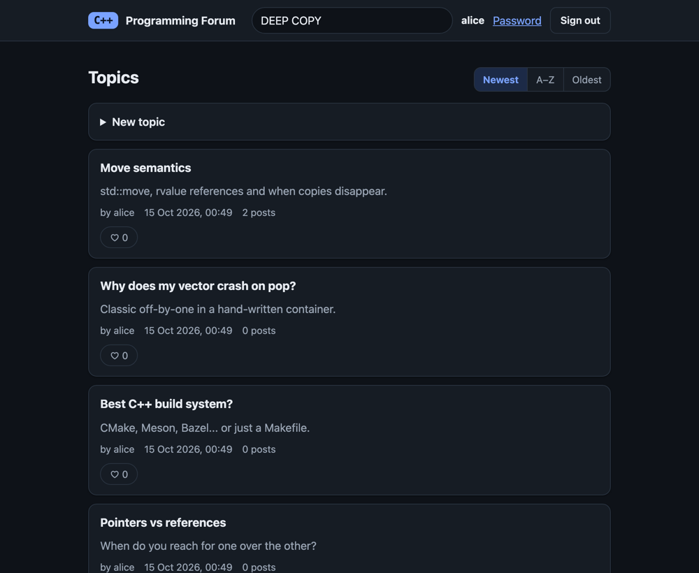

# C++ Programming Forum

A small discussion forum in C++20 with its own data structures. Use it in a browser or in the
terminal: both share one core and one data file. It began as a Data Structures & Algorithms
assignment and was later rebuilt to run on macOS and Linux, with a web interface added.



## Features

- Accounts (salted, iterated SHA-256 password hashes), topics, posts and replies
- One like per user on topics, posts and replies; edit and delete your own posts
- Sort topics (newest, oldest, A-Z) and search topics and posts
- Saved after every change to a single file, `data/forum.db`

## Quick start

Needs a C++20 compiler and `make`. Developed and tested on macOS with Apple clang; Linux with
`clang++` or `g++` should work but is untested (`make CXX=g++` picks a compiler).

```sh
make             # build both programs
make run-web     # web app at http://127.0.0.1:8080
make run         # or the terminal client
```

Both programs take `--data DIR` (default `data`) and `--help`. Only one of them can use a data
directory at a time. The web server listens on localhost only and has no HTTPS, so it is not meant
to be put on the internet (see the [security notes](docs/reference.md#security-notes)).

## Documentation

The diagrams are [Mermaid](https://mermaid.js.org/): GitHub draws them, and VS Code needs a Mermaid
preview extension.

- [Architecture](docs/architecture.md): components, project layout, use cases, user flow, classes, data model, request pipeline
- [Data structures and algorithms](docs/algorithms.md): `HashMap`, `Vector`, merge sort, KMP search, password hashing, costs
- [Processes](docs/processes.md): sequence diagrams and state machines
- [Design decisions](docs/design-decisions.md): patterns, alternatives considered, what changed from the original, test strategy
- [Reference](docs/reference.md): web API, data file format, security notes

## Testing

```sh
make test        # unit tests plus the terminal and web end-to-end scripts
make asan        # the same under AddressSanitizer and UBSan
make tsan        # the same under ThreadSanitizer
make ui-check    # drives the web UI in headless Chrome (needs Node 22+ and Chrome; set CHROME=... if not found)
```

## Credits

Written by Joshua Ng and Armirola Roseller III Tumolva (module group P03) as a DSA assignment, and
later refurbished with the web interface. The HTTP layer is
[cpp-httplib](https://github.com/yhirose/cpp-httplib) by Yuji Hirose, used under the MIT licence
(`third_party/httplib.LICENSE`).
