# C++ Programming Forum

A small discussion forum written in C++20 with its own data structures. You can use it in a
web browser or in the terminal. Both front-ends share one core and one data file.


It began as a Data Structures & Algorithms assignment (terminal only, Windows only). It has since
been rebuilt to run on macOS and Linux, gained a web interface, and had a round of bug fixes
(see [What changed](#what-changed-from-the-original-assignment)).

## Features

- Register, sign in, change password. Passwords are stored as salted, iterated SHA-256 hashes.
- Topics (sortable newest, oldest or A-Z), posts, and replies to posts.
- Like topics, posts and replies, once per user (click again to unlike).
- Edit and delete your own posts. Editing keeps the replies, likes and timestamp.
- Search topics and posts (case-insensitive).
- Everything is saved as you go, so closing the program never loses anything.

| Sign in | A post with replies | Phone |
|---|---|---|
|  |  |  |

## Quick start

You need a C++20 compiler and `make`; nothing else to install. It was developed and tested on macOS
with Apple clang. The code is standard C++20 plus a few POSIX calls (`flock`, `termios`, `isatty`),
so Linux with `clang++` or `g++` should work, but that has not been tried. `make` uses `clang++`
when it is installed; otherwise pass your compiler, e.g. `make CXX=g++`.

```sh
make                 # builds build/forum-web and build/forum
make run-web         # web app at http://127.0.0.1:8080
make run             # or the terminal client
```

Data is kept in `./data/forum.db`. Use `--data DIR` on either program to put it elsewhere. Only one
program can use a data directory at a time (the second one is refused with a clear message), so
stop the web server before using the terminal client, and the other way round.

```sh
build/forum-web --help     # --data DIR  --web DIR  --host ADDR  --port N (0 = any free port)
build/forum --help
```

## How it fits together

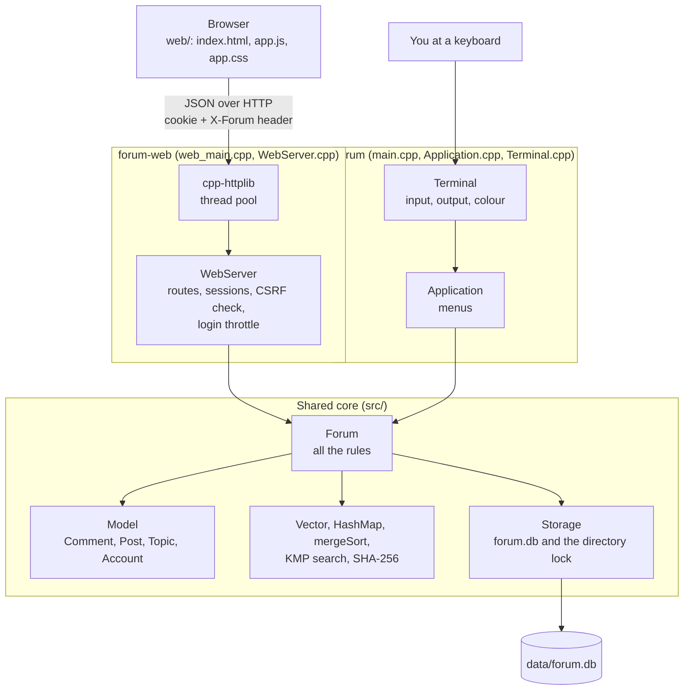

`Forum` knows nothing about HTTP or terminals, so the rules (who may edit what, one like per
user, unique names) live in one place and are unit-tested directly.

More diagrams (use cases, class and data-model diagrams, sequences, state machines, the
algorithms, and the design alternatives that were weighed) are in
[Design and diagrams](#design-and-diagrams).

### The data structures

These are hand-written and are the point of the project. Nothing in `src/` uses `std::vector`,
`std::unordered_map` or `std::sort` for forum data.

| What | Where | How it works | Cost |
|---|---|---|---|
| `Vector<T>` | `src/Vector.h` | Dynamic array; capacity doubles when full | push amortised O(1), `removeAt` O(n), index O(1) |
| `HashMap<K,V>` | `src/HashMap.h` | Separate chaining, 64-bit FNV-1a over every byte, doubles at load factor 0.75, rehash relinks nodes so pointers stay valid | find/insert/erase O(1) average |
| `mergeSort` | `src/Sort.h` | Stable top-down merge sort that moves elements instead of copying | O(n log n), O(n) scratch |
| `containsIgnoreCase` | `src/StringSearch.cpp` | Knuth-Morris-Pratt substring search | O(n + m) |
| SHA-256 | `src/Sha256.cpp` | FIPS 180-4, checked against the NIST vectors | |

Where they are used: accounts and web sessions live in a `HashMap`; topic ordering is a
`mergeSort` over topic indices (so each viewer can pick their own order without changing stored
data); search uses KMP; every list in the program is a `Vector`.

### Project layout

```
src/        the C++ code
  Vector.h HashMap.h Sort.h StringSearch.* Sha256.*     data structures and algorithms
  Comment.* Post.h Topic.h Account.*                    the model
  Storage.*   forum.db reader/writer and the directory lock
  Forum.*     the forum's rules (shared by both front-ends)
  WebServer.* Json.h web_main.cpp                       web front-end (forum-web)
  Terminal.* Application.* main.cpp                     terminal front-end (forum)
web/        the browser app: index.html, app.js, app.css
tests/      unit tests, end-to-end scripts, and the browser check
third_party/httplib.h    cpp-httplib v0.58.0 (MIT), the only third-party code
```

## Testing

```sh
make test       # 7 unit-test programs + CLI and web end-to-end scripts
make asan       # the same, built with AddressSanitizer and UBSan
make tsan       # the same, built with ThreadSanitizer (checks the web server's locking)
make ui-check   # drives the real web UI in headless Chrome and saves screenshots
```

`make ui-check` needs Node 22+ and Google Chrome or Chromium (set `CHROME=/path/to/browser` if it is
not found). It is separate from `make test` for that reason.

What is covered: the containers (including the collision, growth and removal cases that were
broken before), the storage round trip with hostile text, every rule in `Forum`, the web API
(auth, CSRF header, ownership, escaping, 40 concurrent writers, restart persistence), scripted
terminal sessions (including end-of-input and the directory lock), and a browser walkthrough that
fails on any console error or Content-Security-Policy violation.

## Web API

All responses are JSON. Errors look like `{"error": "..."}` with a 400, 401, 403, 404, 409 or 429
status. Every `POST` must send the header `X-Forum: 1` and form-encoded parameters.
Everything except `register`, `login` and `me` needs a session.

| Method and path | Parameters | |
|---|---|---|
| `GET /api/me` | | Current user (or `null`) and input limits |
| `POST /api/register` | `username`, `password` | Creates the account and signs in |
| `POST /api/login` | `username`, `password` | |
| `POST /api/logout` | | |
| `POST /api/password` | `old`, `new` | |
| `GET /api/topics` | `sort` = `time`, `alpha` or `none` | Sorting is per request, not stored |
| `POST /api/topics` | `title`, `description` | |
| `GET /api/topics/:t` | | Topic and its posts |
| `POST /api/topics/:t/like` | | Toggles; returns `{liked, likes}` |
| `POST /api/topics/:t/posts` | `text` | |
| `GET /api/topics/:t/posts/:p` | | Post and its replies |
| `POST /api/topics/:t/posts/:p/like` | | |
| `POST /api/topics/:t/posts/:p/edit` | `text` | Author only (403 otherwise) |
| `POST /api/topics/:t/posts/:p/delete` | | Author only |
| `POST /api/topics/:t/posts/:p/replies` | `text` | |
| `POST /api/topics/:t/posts/:p/replies/:r/like` | | |
| `GET /api/search` | `q` | Topic and post hits |

## Data file

One file, `forum.db`: text, one record per line, tab-separated, with tabs, newlines and backslashes
inside fields escaped, so nothing a user types can break the format. Nothing a user types is ever
used as a file name. It is written to a temporary file and renamed into place, so a crash cannot
leave half a file. If a line cannot be read it is skipped (and the original is kept as
`forum.db.bak`). A file that is not a forum file at all is never overwritten.

```
FORUM<TAB>2
META<TAB>nextId<TAB>terminalSortMode
ACCOUNT<TAB>username<TAB>salt<TAB>hash
TOPIC<TAB>id<TAB>created<TAB>author<TAB>title<TAB>description[<TAB>liker...]
POST<TAB>id<TAB>created<TAB>author<TAB>edited<TAB>text[<TAB>liker...]     (belongs to the TOPIC above)
REPLY<TAB>id<TAB>created<TAB>author<TAB>text[<TAB>liker...]               (belongs to the POST above)
```

## Security notes

This is a learning project, not something to put on the internet as is.

- **No HTTPS.** The web server listens on `127.0.0.1` only by default and refuses requests whose
  `Host` is not a loopback name (protection against DNS rebinding). If you pass `--host` with
  another address it warns you: passwords and session cookies would travel in clear text.
- **Passwords** are hashed with 10,000 rounds of salted SHA-256 and compared in constant time. That
  is far better than plain text but weaker than a purpose-built scheme: use argon2, scrypt or bcrypt
  for anything real. Repeated failed logins are throttled.
- **Sessions** are random 256-bit tokens in `HttpOnly`, `SameSite=Strict` cookies, kept in memory
  (so a server restart signs everyone out) and expiring after a day idle.
- **Cross-site requests** are blocked by requiring the `X-Forum` header on every `POST` and never
  enabling CORS. **Cross-site scripting** is prevented by rendering all user text with
  `textContent`, escaping `<`, `>` and `&` in JSON, and a Content-Security-Policy.
- Control characters (including terminal escape sequences) are rejected on input and replaced when
  shown, so stored text cannot drive someone's terminal.

## What changed from the original assignment

The terminal menus, the ASCII logo and the overall feature set are the same. Fixed along the way:

- It only built on Windows (`Windows.h`, `Sleep`, `localtime_s`, a Visual Studio project). It now
  builds anywhere with a C++20 compiler.
- **Accounts could overwrite each other.** The hash gave every non-letter the same value (so
  `user1` and `user2` collided) and `Map::push` returned the wrong node on a collision, replacing
  another user's account.
- Deleting a post corrupted the list (`Vector::pop` advanced the wrong index), and the container
  had double-free bugs in its copy and move assignment.
- Replies were duplicated on every save, and file names were built from user text: a topic called
  `Topics` overwrote the data file, a `/` in a post broke saving, and a `;` crashed the next start.
  Storage is now one safely escaped file.
- The edit/delete permission was checked against the topic's starter instead of the signed-in
  user: anyone could delete the starter's posts by typing the hidden command, while other people
  could not edit their own. Editing a post also threw away its replies, likes and date.
- End of input made the program loop forever, and data was only saved on a clean exit.
- Selection sort copied whole topics on every swap; it is now a merge sort that moves them.
- Likes were unlimited; there is now one per user.

## Design and diagrams

Every diagram below is [Mermaid](https://mermaid.js.org/), so GitHub draws them from the text.
(VS Code's built-in preview does not; the *Markdown Preview Mermaid Support* extension adds it.)

- [Who uses it](#who-uses-it): use cases and the user flow in the web app
- [Structure](#structure): classes, where each data structure is used, the file's data model
- [Data structures in detail](#data-structures-in-detail): `HashMap` and `Vector`
- [Algorithms](#algorithms): merge sort, topic ordering, KMP search, password hashing, SHA-256, and what each operation costs
- [Processes](#processes): start-up, sign-in, writing a post, likes, editing, search, a terminal session, saving
- [State machines](#state-machines): sessions, the login throttle, the file loader
- [A web request, and concurrency](#a-web-request-and-concurrency)
- [Design methods](#design-methods): patterns used, decisions with the alternatives, original design versus now
- [Test strategy](#test-strategy)

### Who uses it

#### Use cases

There are no administrators or moderators: nobody can edit or delete another person's content, and
there is no way to delete a topic.

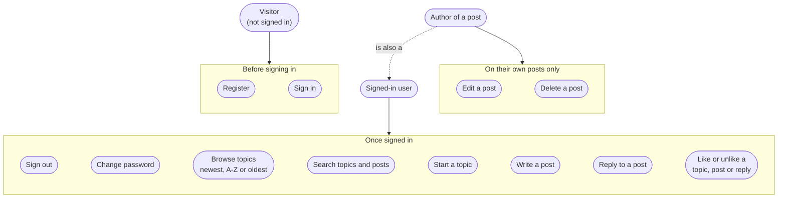

#### User flow in the web app

Each box is a screen of the single-page app (`web/app.js`); the labels are its URL hashes.

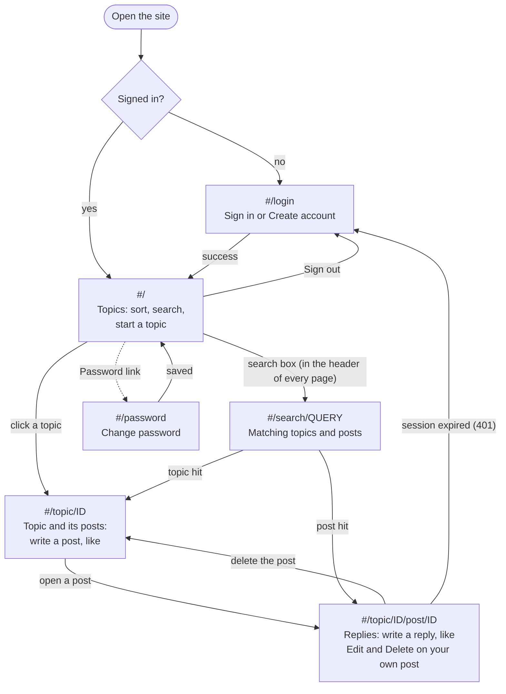

### Structure

#### Classes

The model is three small classes and an account. `Post` and `Topic` extend `Comment` so that
likes, ids, authors and timestamps are written once.

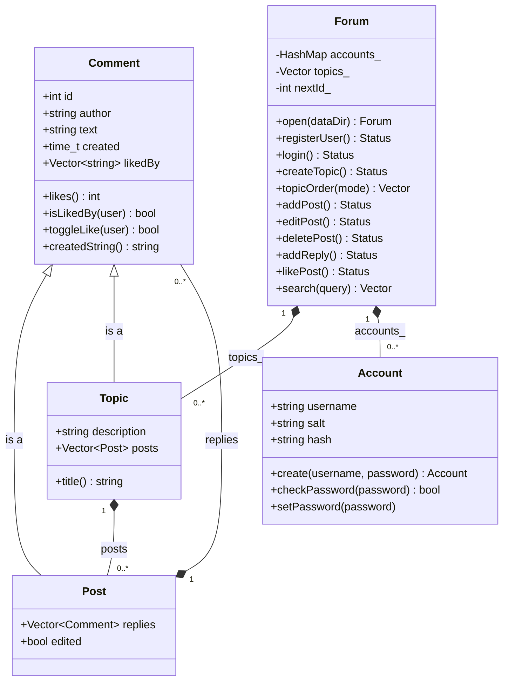

#### Where each data structure is used

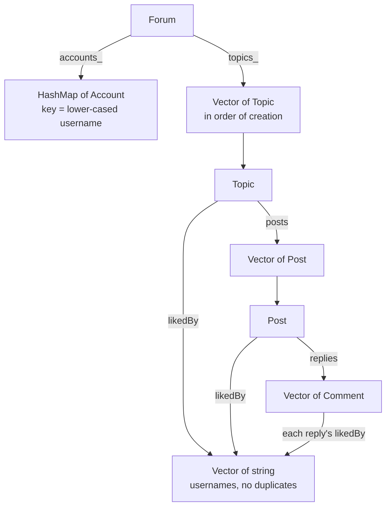

Short-lived structures and the web layer's own tables:

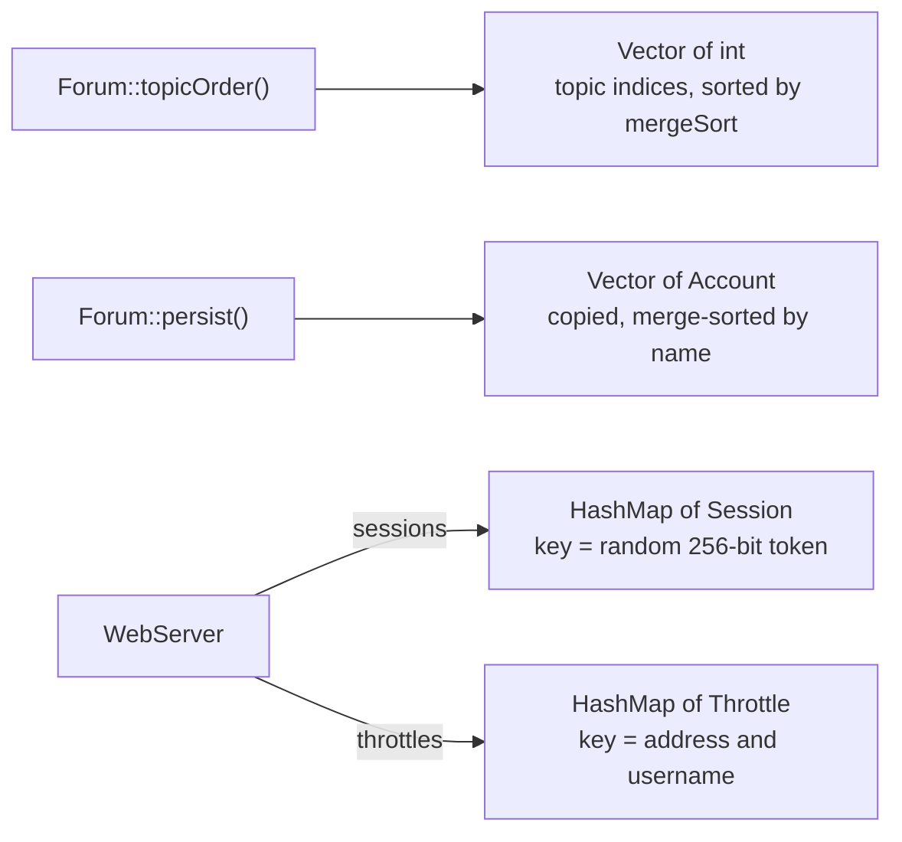

#### Data model on disk

The same shape as `forum.db` (see [Data file](#data-file)). Likes are not a separate table: each
topic, post and reply carries the list of usernames who like it. A post belongs to the topic whose
`TOPIC` line is above it in the file, and a reply to the `POST` line above it.

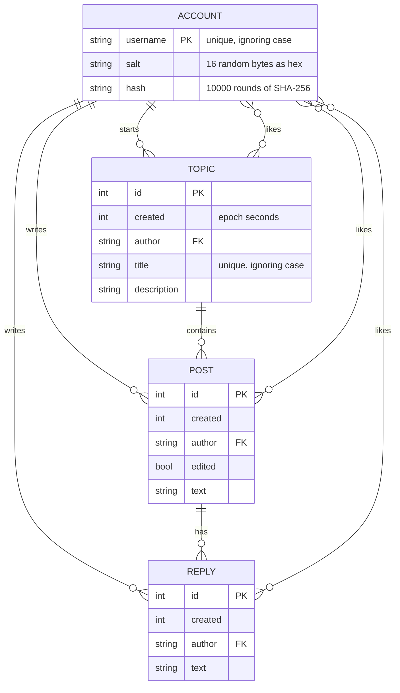

### Data structures in detail

#### HashMap

`src/HashMap.h`. A key is hashed, reduced to a bucket, and the bucket holds a chain of nodes. New
nodes go on the front of the chain (so `user1`, added after `alice`, comes first). Accounts and web
sessions are stored this way. The array starts
at 16 buckets and doubles when `size / buckets` would pass 0.75.

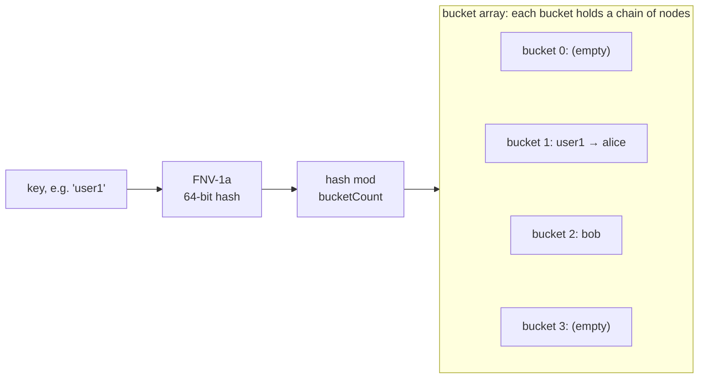

`insertOrAssign` in full. On a resize the existing nodes are *relinked* into the new array, not
copied, so a pointer returned earlier by `find` stays valid until that entry is erased.

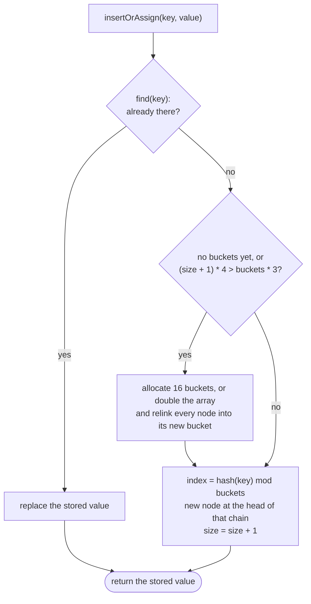

#### Vector

`src/Vector.h`. Capacity doubles, so `push` is amortised O(1). The old version grew by 4 each
time, which is O(n) per push in the long run.

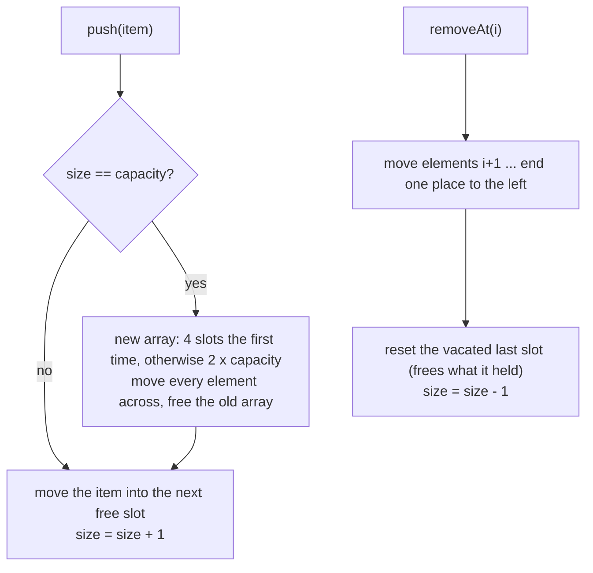

#### Why accounts used to overwrite each other

The original `Map` had two bugs that combined. Both are covered by the unit tests now: one forces
every key into the same bucket and removes from the head, middle and tail of the chain.

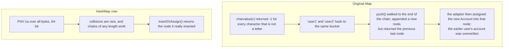

### Algorithms

#### Merge sort and topic ordering

`src/Sort.h`. Top-down merge sort, O(n log n) time and O(n) scratch space. It *moves* elements
instead of copying them (the old selection sort copied whole topics, with all their posts, on every
swap). It takes from the right run only when strictly smaller, so equal items keep their original
order. The example below has two equal 2s (`2a` came first) and shows `2a` staying ahead of `2b`.

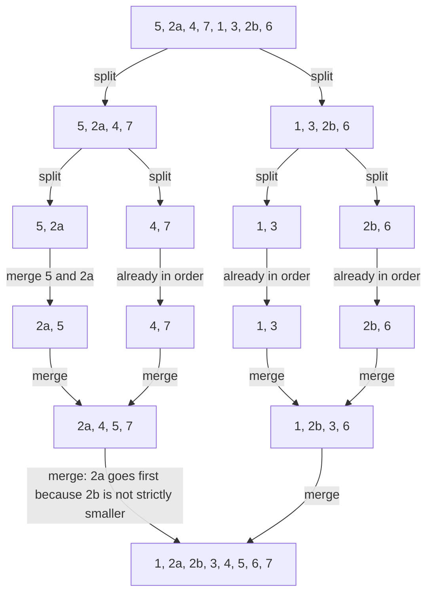

Topics are never reordered in memory. `topicOrder` builds a list of *indices* and sorts that, so
each web visitor can pick their own order, a sort needs no write to disk, and the stored `topics_`
vector always stays in order of creation.

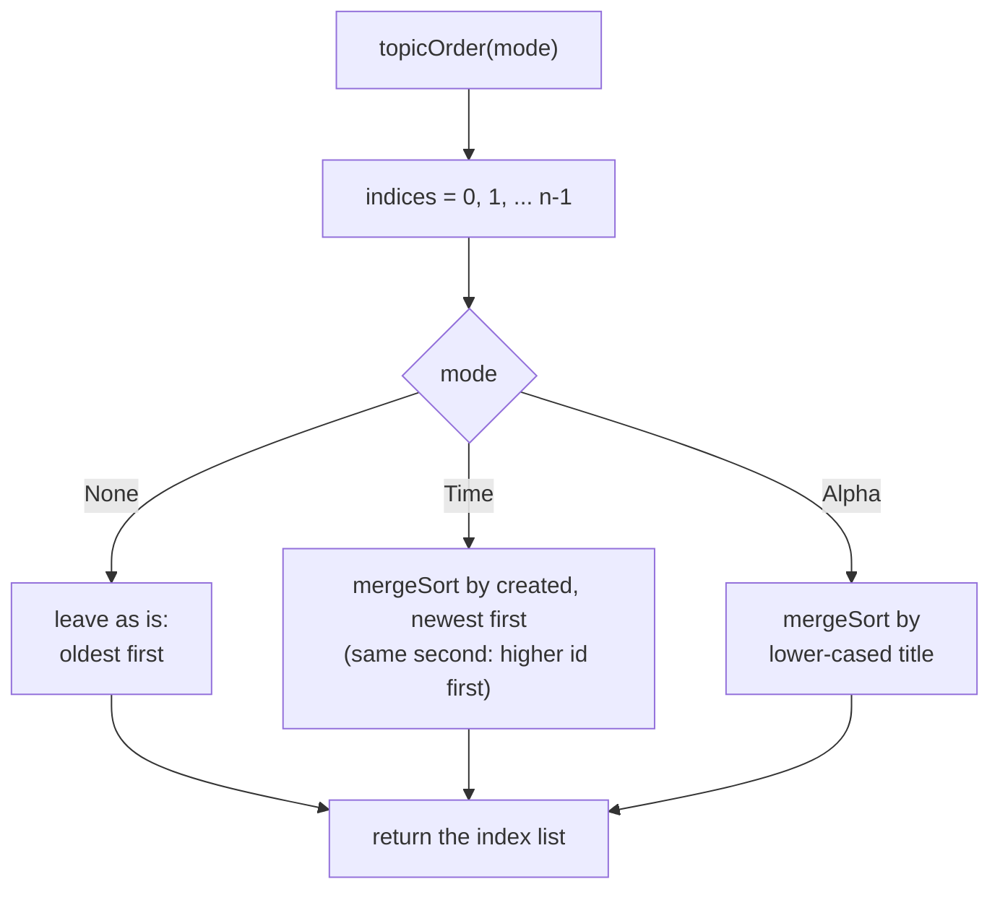

#### Substring search (KMP)

`src/StringSearch.cpp`. Knuth-Morris-Pratt, O(n + m), case-insensitive for ASCII. The prefix table
holds, for each position `i`, the length of the longest proper prefix of `pattern[0..i]` that is also
a suffix of it. When a character does not match, the table says how far to fall back inside the
pattern, so the text is read exactly once and never backed over.

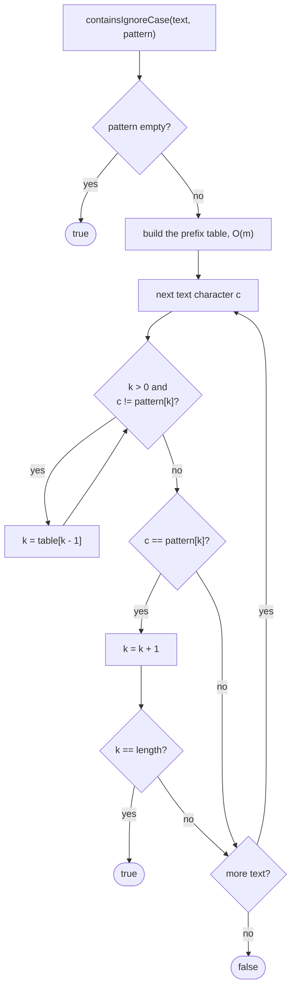

Worked example, pattern `ababc` in text `abababc`. The prefix table is `0 0 1 2 0`.

| Text character | Matched before (k) | Step | k after |
|---|---|---|---|
| a | 0 | matches `a` | 1 |
| b | 1 | matches `b` | 2 |
| a | 2 | matches `a` | 3 |
| b | 3 | matches `b` | 4 |
| a | 4 | `c` expected, no match: fall back to `table[3]` = 2, then `a` matches pattern[2] | 3 |
| b | 3 | matches `b` | 4 |
| c | 4 | matches `c`, k equals the pattern length | 5, found |

#### Password hashing and SHA-256

`src/Sha256.cpp`, `src/Account.cpp`. SHA-256 is written by hand and checked against the NIST test
vectors. A password is never stored: only a random salt and the result of 10,000 rounds. For a
username that does not exist, login still does the same amount of hashing, so how long it takes
does not reveal which names are registered.

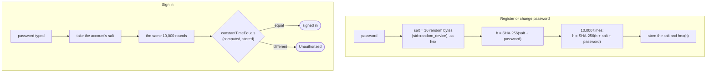

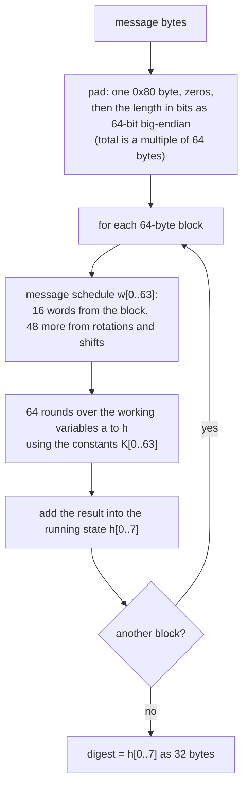

#### What the main operations cost

*T* topics, *P* posts in a topic, *A* accounts, *L* likes on one item, *N* the total size of the data.

| Operation | Cost | Why |
|---|---|---|
| Find an account | O(1) average | `HashMap` |
| Check a password | constant, about 10,000 SHA-256 rounds | deliberately slow |
| Find a topic by id | O(T) | linear scan of `topics_` |
| Find a post by id | O(T + P) | scan for the topic, then its posts |
| Order the topics | O(T log T) | `mergeSort` on indices |
| Add a post | O(T + P) plus a save | find the topic, compare text with its posts |
| Like or unlike | O(L) plus a save | `likedBy` is a `Vector`, searched linearly |
| Search | O(total text) | one KMP pass per title, description and post |
| Save | O(N + A log A) | the whole file is rewritten, accounts sorted by name |

The linear scans and the full rewrite on every change are the main trade-offs: fine for a forum of
this size, and the first things to change (an id index, an append-only log or a database) if it grew.

### Processes

#### Start-up

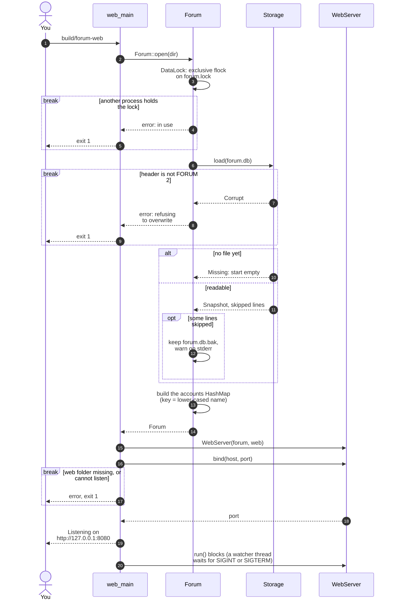

#### Signing in

The throttle, the session table and the password check are separate pieces; the web layer owns the
first two and `Forum` owns the last.

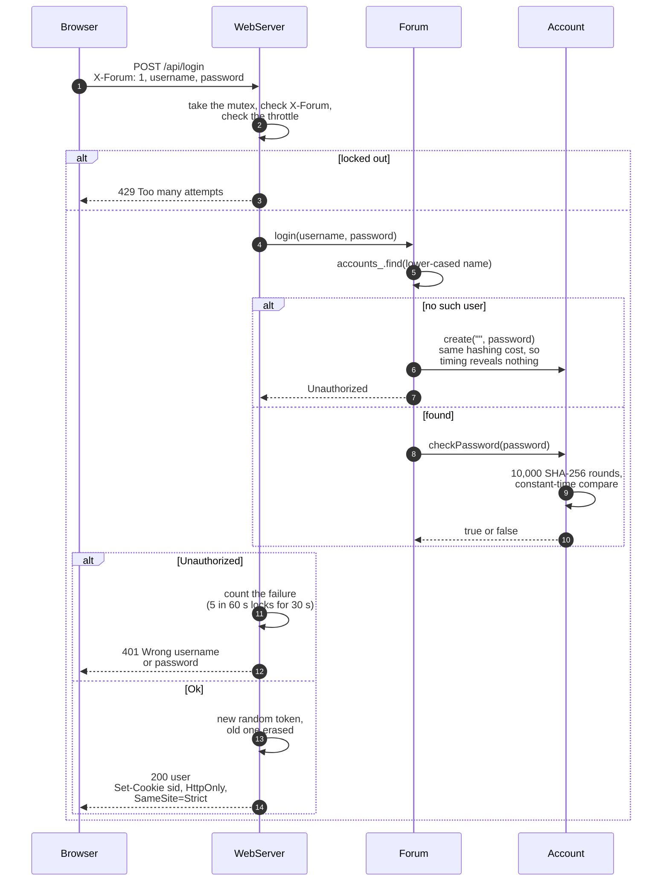

#### Writing a post

Every change follows the same path: authenticate, validate, change memory, save, answer.

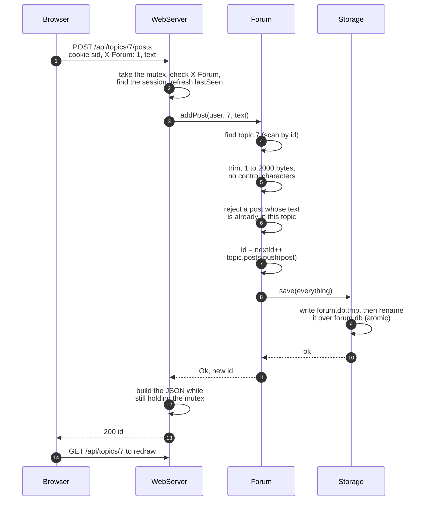

#### Liking

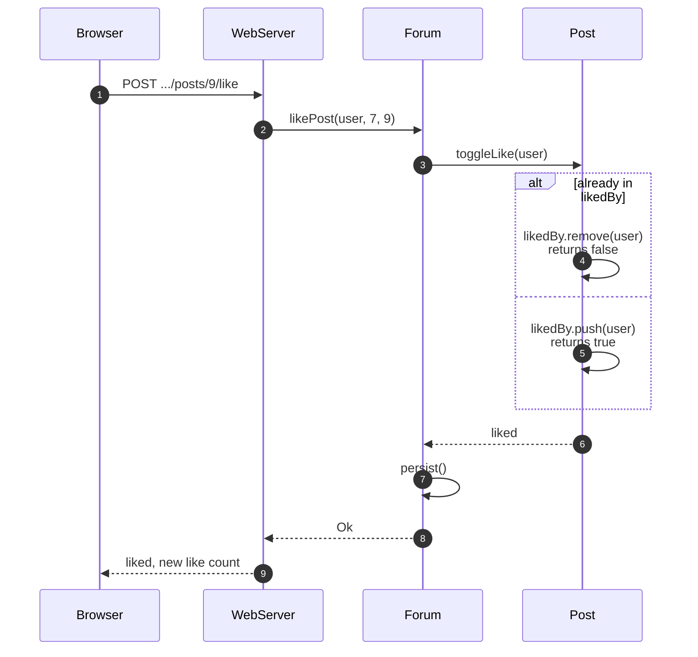

#### Editing and ownership

The check is against the signed-in user. (The original compared against the topic's starter.)
Editing changes the text in place, so replies, likes, id and creation time all stay.

```mermaid
sequenceDiagram
    autonumber
    participant B as Browser
    participant W as WebServer
    participant F as Forum

    B->>W: POST /api/topics/7/posts/9/edit<br/>text
    W->>F: editPost(user, 7, 9, text)
    alt topic or post not found
        F-->>W: NotFound
        W-->>B: 404
    else post.author is not the signed-in user
        F-->>W: Forbidden
        W-->>B: 403 You can only edit your own posts
    else text empty, too long or has control characters
        F-->>W: Invalid
        W-->>B: 400
    else text identical to what it already is
        F-->>W: Ok, nothing changes
        W-->>B: 200
    else another post in the topic has this text
        F-->>W: Conflict
        W-->>B: 409
    else
        F->>F: post.text = text, post.edited = true
        F->>F: persist()
        F-->>W: Ok
        W-->>B: 200
    end
```

#### Search

```mermaid
sequenceDiagram
    autonumber
    participant B as Browser
    participant W as WebServer
    participant F as Forum
    participant K as containsIgnoreCase

    B->>W: GET /api/search?q=deep copy
    W->>F: search(q)
    F->>F: trim q (empty: no hits)
    loop every topic
        F->>K: title, then description
        K-->>F: match or not
        loop every post in it
            F->>K: post text
            K-->>F: match or not
        end
    end
    F-->>W: hits: topic id,<br/>post id (0 = the topic), text
    W->>W: cut each text to 160 bytes<br/>(never inside a UTF-8 character)
    W-->>B: 200 hits
```

#### A terminal session

The terminal client calls the same `Forum` methods. At the end of input (Ctrl-D, or a closed pipe)
it throws a private exception that unwinds out of whichever menu is open, so it cannot loop forever.

```mermaid
sequenceDiagram
    autonumber
    actor U as You
    participant T as Terminal
    participant A as Application
    participant F as Forum

    loop until Exit or end of input
        A->>T: clear the screen<br/>(real terminal only)
        A->>U: print the menu
        A->>T: ask("Your choice? ")
        T->>U: show the prompt
        alt a line arrives
            U-->>T: text
            T-->>A: line
            Note over A,F: every pass re-finds its topic or post by id,<br/>and returns if it was deleted
            A->>F: e.g. addPost(user, topicId, text)
            F-->>A: Status
            A->>U: green or red message<br/>(0.8 s pause on a terminal)
        else end of input
            T-->>A: false
            A->>A: throw EndOfInput
            A-->>U: "End of input. Goodbye!"<br/>exit code 0
        end
    end
```

#### Saving to disk

The file is replaced as a whole, atomically, so a crash or a full disk can never leave half a file.

```mermaid
flowchart TD
    chg["any change: addPost, likePost, ..."] --> mem["update the in-memory structures"]
    mem --> per["persist(): sort the accounts by name (mergeSort),<br/>write every record to forum.db.tmp"]
    per --> good{"written and flushed OK?"}
    good -- no --> del["delete the temporary file"]
    good -- yes --> mv["rename forum.db.tmp over forum.db"]
    mv --> okmv{"rename OK?"}
    okmv -- no --> del
    okmv -- yes --> done(["Status::Ok"])
    del --> fail(["Status::Internal: the change stays in memory,<br/>the old file is intact"])
```

### State machines

#### A web session

```mermaid
stateDiagram-v2
    [*] --> Active: sign in or register<br/>(a brand-new random token)
    Active --> Active: any request with the cookie<br/>(lastSeen is refreshed)
    Active --> [*]: sign out
    Active --> [*]: signing in again<br/>(the old token is erased)
    Active --> Expired: idle for more than 24 hours
    Expired --> [*]: removed on its next use or by a sweep
    Active --> [*]: the server restarts<br/>(sessions live in memory only)
```

#### The login throttle

One entry per remote address and username. A failure that arrives after the 60 s window has passed
starts the count again at 1.

```mermaid
stateDiagram-v2
    [*] --> Open
    Open --> Counting: a failed login
    Counting --> Counting: another failed login<br/>(fewer than 5 inside the 60 s window)
    Counting --> Locked: the 5th failure inside the window
    Counting --> Open: a successful login
    Locked --> Locked: an attempt (answered 429, password not checked)
    Locked --> Open: 30 seconds pass
```

#### Reading the data file

Lines that cannot be parsed are skipped and counted rather than aborting the load. A `POST` needs a
good `TOPIC` before it, and a `REPLY` a good `POST`, so one damaged line cannot attach later lines
to the wrong parent.

```mermaid
stateDiagram-v2
    [*] --> NoTopic
    NoTopic --> TopicOnly: TOPIC parsed
    NoTopic --> NoTopic: TOPIC damaged, or a POST or REPLY with no parent (skipped)
    TopicOnly --> TopicOnly: TOPIC parsed, or a REPLY with no post (skipped), or a damaged POST (skipped)
    TopicOnly --> NoTopic: TOPIC damaged
    TopicOnly --> TopicAndPost: POST parsed
    TopicAndPost --> TopicAndPost: POST parsed, or REPLY parsed, or a damaged REPLY (skipped)
    TopicAndPost --> TopicOnly: TOPIC parsed, or a damaged POST (skipped)
    TopicAndPost --> NoTopic: TOPIC damaged
```

### A web request, and concurrency

The pipeline every request goes through, in order. "Host OK?" means the `Host` header names a loopback
address (`localhost`, `127.0.0.1` or `[::1]`) when the server is listening on loopback; "valid sid
cookie?" means a known token that has not been idle for over 24 hours; the mutex is released when
the response has been built. Every response, including errors and static
files, also carries `Content-Security-Policy`, `X-Content-Type-Options: nosniff`,
`X-Frame-Options: DENY`, `Referrer-Policy: no-referrer` and `Cache-Control: no-store`.

```mermaid
flowchart TD
    req["HTTP request"] --> host{"Host OK?"}
    host -- "no: not a loopback name" --> r403a["403, blocks DNS rebinding"]
    host -- yes --> static{"file in web/?"}
    static -- yes --> file["serve the file"]
    static -- no --> route{"/api route?"}
    route -- no --> r404["404"]
    route -- "yes: take the global mutex" --> csrf{"POST without<br/>X-Forum: 1?"}
    csrf -- yes --> r403b["403, blocks cross-site forgery"]
    csrf -- no --> needs{"needs a session?"}
    needs -- yes --> sess{"valid sid cookie?"}
    sess -- no --> r401["401 Sign in required"]
    sess -- yes --> handler
    needs -- no --> handler["run the handler (call Forum, build the JSON),<br/>release the mutex, send the response"]
```

There are two levels of locking. Threads inside the web server share one mutex. Separate
programs are kept apart by a file lock, because each one holds all the data in memory and rewrites
the file: two of them at once would silently overwrite each other's changes.

```mermaid
flowchart LR
    subgraph proc["forum-web process"]
        t1["worker thread 1"] --> mu(("mutex"))
        t2["worker thread 2"] --> mu
        t3["worker thread N"] --> mu
        mu --> state["Forum, sessions,<br/>throttles (memory)"]
    end
    state --> db[("data/forum.db")]
    state --> lockf[/"data/forum.lock<br/>(flock, held while running)"/]
    cli["terminal client or<br/>a second forum-web"] -. "refused" .-> lockf
```

### Design methods

#### Patterns and idioms

| Idea | Where | What it buys |
|---|---|---|
| Layered architecture, separation of concerns | front-ends, `Forum`, `Storage`, data structures | Rules live in one place and are testable without HTTP or a terminal |
| Facade | `Forum` | One small API in front of the model, storage and algorithms |
| Whole-state snapshot persistence | `storage::Snapshot`, `Forum::persist` | Simple, atomic, no partial updates to reason about |
| RAII | `Vector`, `HashMap` own their memory; `DataLock` closes its file (releasing the lock); `std::lock_guard` | No leaks, locks released on every path |
| Rule of five with copy-and-swap | `Vector`, `HashMap` | Safe copy, move and self-assignment (the original had double-free bugs here) |
| Strategy through templates | `HashMap<K, V, Hash>`, `mergeSort(vec, Less)` | The tests swap in a hash that sends every key to one bucket |
| Status codes for expected failures | `Forum` returns `Status` | "Not allowed" or "already exists" are normal outcomes, not exceptions |
| An exception only to unwind | `EndOfInput` in the terminal client | Leaves any depth of menu at the end of input |
| Stable surrogate keys | integer ids from a persisted counter | Positions shift on delete and sort; several browsers act at once |
| Pure ordering function | `topicOrder` | Sorting is a view, not a change to shared state |
| Validate at the boundary, then escape per context | `Forum` input rules; the file format escaping; JSON escaping; `textContent` in the browser | User text cannot break the file, the page or a terminal |
| Defence in depth | Host check, `X-Forum` header, `SameSite=Strict`, CSP, throttle | No single check is the only thing standing between a request and the data |

#### Decisions and the alternatives

| Decision | Chosen | Alternatives | Why |
|---|---|---|---|
| Containers | Hand-written `Vector` and `HashMap` | The standard library's | They are the point of a DSA project; now correct and unit-tested |
| Build | A plain `Makefile` | CMake | Nothing extra to install; CMake would only matter if Windows came back |
| Storage | One escaped text file, saved atomically | A file per topic and per post (the original); SQLite; JSON | No dependency, readable, and nothing a user types becomes a file name. Cost: the whole file is rewritten on every change |
| Identity | Integer ids | Array positions | Positions change on delete and sort |
| Topic order | Computed per request | Sorting the stored vector (the original) | Each viewer picks their own order and nothing is written |
| Sort | Stable merge sort | Selection sort (the original), quicksort, insertion sort | O(n log n) in every case and stable. Quicksort is not stable and has an O(n²) worst case |
| Collisions | Separate chaining | Open addressing | Deleting is simple, and nodes never move, so pointers stay valid across a resize |
| Hash function | FNV-1a over all bytes | The original rolling hash (non-letters all counted as -1), `std::hash` | Simple, uses every byte, and is defined by this project rather than left to the standard library's implementation |
| Vector growth | Doubling | Adding 4 each time (the original) | Amortised O(1) |
| Search | KMP scan of the text | A naive scan; an inverted index | O(n + m) and a classic algorithm. An index would be faster for a large forum but must be kept in step with every edit |
| HTTP | cpp-httplib (one MIT header) | Writing an HTTP server; a bigger framework | Parsing HTTP is not what this project is about and is easy to get wrong |
| Front-end | Plain JavaScript, no build step | A framework; server-rendered pages | No dependencies, and `textContent` makes the XSS rule easy to follow |
| Thread safety | One global mutex | A lock per object; a single-threaded event loop | Simple and clearly correct, and checked with ThreadSanitizer. Throughput is not a concern here |
| Two processes | An exclusive file lock | Letting both run and merging; a database | Each process keeps everything in memory, so concurrent writers would lose updates |
| Passwords | Hand-written salted, iterated SHA-256 | Plain text (the original); bcrypt, scrypt or argon2 | Keeps the project free of dependencies and shows the idea. Real systems should use a purpose-built scheme |
| Sessions | Random tokens in an in-memory `HashMap` | Signed cookies or JWTs; a database table | Signing out is just deleting an entry, and there is no signing key to manage. Cost: a restart signs everyone out |
| Cross-site forgery | A required custom header, plus `SameSite=Strict` | A token in every form | Simple with `fetch`, and a page on another site cannot add the header without CORS |
| Likes | A list of usernames on each item | A bare counter | One like per user, and unliking, both need to know who |
| Editing | In place | Delete and re-create (the original) | Keeps replies, likes, id and creation time |
| Errors | `Status` values | Exceptions | Failures like "forbidden" are expected and easy to test |

#### From the original design to now

```mermaid
flowchart LR
    subgraph before["Original assignment"]
        direction TB
        o1["Application<br/>menus, rules and file handling together;<br/>held an Account pointer and references into Vectors"]
        o2["DataAccessor of T and D, with AccountDA and TopicDA<br/>read in the constructor, wrote in the destructor"]
        o3["Map with protected members,<br/>wrapped by AccountMapAdapter"]
        o4["Tools: selectionSort, split, time helpers"]
        o5["Windows-only calls:<br/>console mode, Sleep, localtime_s"]
        o6["Files named from user text:<br/>Topics.txt, Title.txt, Title_post.txt"]
    end
    subgraph after["Now"]
        direction TB
        n1["Application (menus only)<br/>and WebServer (HTTP only)"]
        n2["Forum: rules, ids, ownership"]
        n3["Storage: one escaped file,<br/>saved after every change"]
        n4["HashMap, used directly"]
        n5["Sort.h, StringSearch, Sha256:<br/>one idea per file"]
        n6["Terminal: isatty, termios,<br/>a plain mode for pipes and tests"]
        n7["forum.db: nothing a user types<br/>becomes a file name"]
    end
    o1 -.-> n1
    o1 -.-> n2
    o2 -.-> n3
    o3 -.-> n4
    o4 -.-> n5
    o5 -.-> n6
    o6 -.-> n7
```

### Test strategy

Each layer is checked on its own, and the layers above check them again from the outside.
`make asan` and `make tsan` rerun everything under the sanitizers; `make test` is the quick run.

```mermaid
flowchart BT
    u["Data structure unit tests<br/>test_vector, test_hashmap, test_sort, test_search, test_sha256"] --> f["Core tests<br/>test_storage, test_forum"]
    f --> e["End-to-end scripts<br/>cli_e2e.sh (terminal), web_e2e.sh (HTTP API)"]
    e --> b["Browser walkthrough<br/>make ui-check (headless Chrome)"]
    s["Sanitizers<br/>make asan: AddressSanitizer and UBSan<br/>make tsan: ThreadSanitizer"] -.-> u
    s -.-> f
    s -.-> e
```

## Credits

Written by Joshua Ng and Armirola Roseller III Tumolva (module group P03) as a DSA assignment, and
later refurbished with the web interface. The HTTP layer is
[cpp-httplib](https://github.com/yhirose/cpp-httplib) by Yuji Hirose, used under the MIT licence
(`third_party/httplib.LICENSE`).
