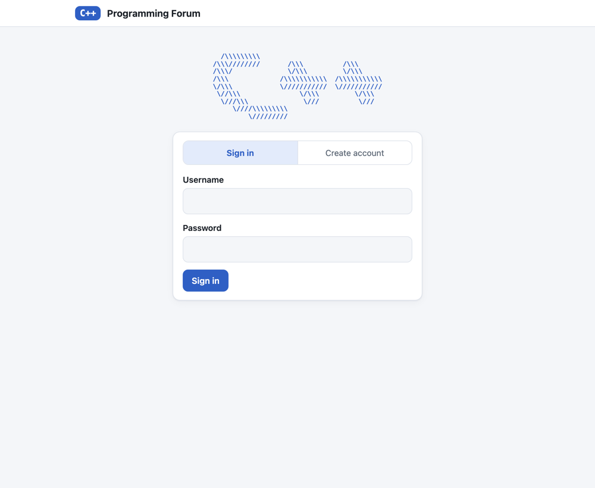
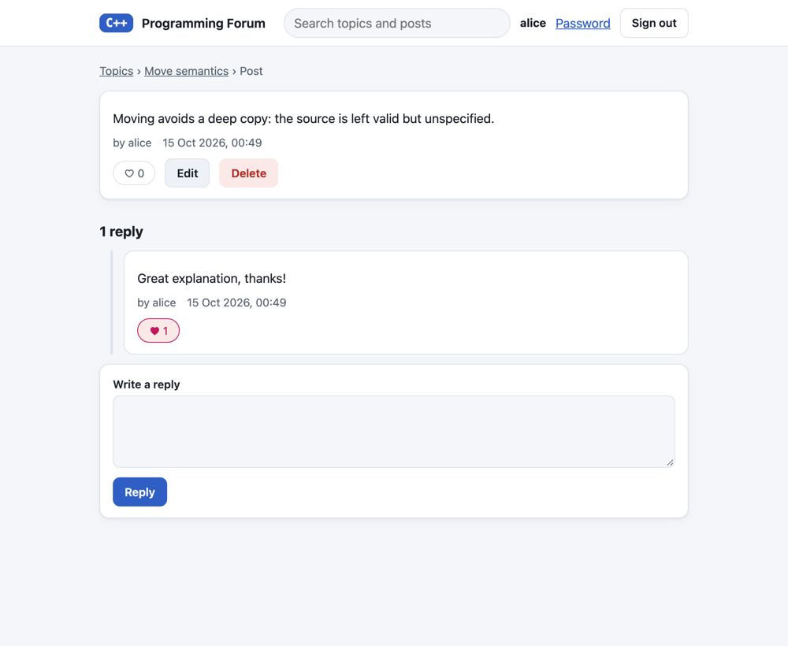
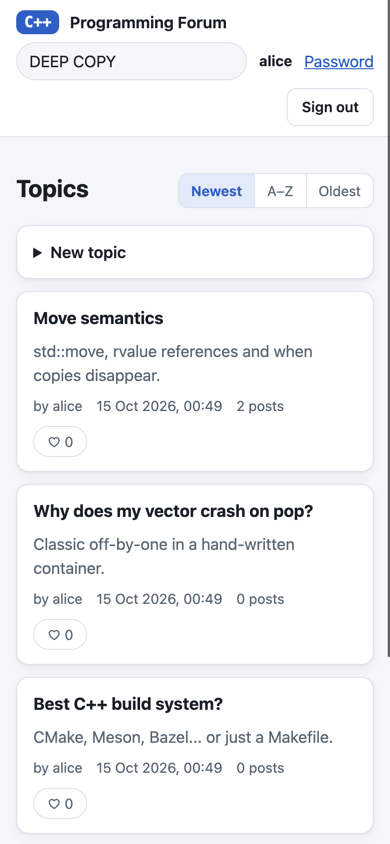

# C++ Programming Forum

A small discussion forum written in C++20 with its own data structures. You can use it in a
web browser or in the terminal. Both front-ends share one core and one data file.


It began as a Data Structures & Algorithms assignment (terminal only, Windows only). It has since
been rebuilt to run on macOS and Linux, gained a web interface, and had a round of bug fixes
(see [What changed](#what-changed-from-the-original-assignment)).

## Features

- Register, sign in, change password. Passwords are stored as salted, iterated SHA-256 hashes.
- Topics (sortable newest, oldest or A-Z), posts, and replies to posts.
- Like topics, posts and replies, once per user (click again to unlike).
- Edit and delete your own posts. Editing keeps the replies, likes and timestamp.
- Search topics and posts (case-insensitive).
- Everything is saved as you go, so closing the program never loses anything.

| Sign in | A post with replies | Phone |
|---|---|---|
|  |  |  |

## Quick start

You need a C++20 compiler (`clang++` or `g++`) and `make`. Nothing else to install.

```sh
make                 # builds build/forum-web and build/forum
make run-web         # web app at http://127.0.0.1:8080
make run             # or the terminal client
```

Data is kept in `./data/forum.db`. Use `--data DIR` on either program to put it elsewhere. Only one
program can use a data directory at a time (the second one is refused with a clear message), so
stop the web server before using the terminal client, and the other way round.

```sh
build/forum-web --help     # --data DIR  --web DIR  --host ADDR  --port N (0 = any free port)
build/forum --help
```

## How it fits together

```
browser ── web/ (HTML + CSS + JS, no build step)
   │  JSON over HTTP, cookie session
build/forum-web ── WebServer (cpp-httplib) ─┐
build/forum     ── Application (terminal)  ─┼─► Forum (all the rules) ─► Storage ─► data/forum.db
                                            └─► Vector · HashMap · mergeSort · KMP · SHA-256
```

`Forum` knows nothing about HTTP or terminals, so the rules (who may edit what, one like per
user, unique names) live in one place and are unit-tested directly.

### The data structures

These are hand-written and are the point of the project. Nothing in `src/` uses `std::vector`,
`std::unordered_map` or `std::sort` for forum data.

| What | Where | How it works | Cost |
|---|---|---|---|
| `Vector<T>` | `src/Vector.h` | Dynamic array; capacity doubles when full | push amortised O(1), `removeAt` O(n), index O(1) |
| `HashMap<K,V>` | `src/HashMap.h` | Separate chaining, 64-bit FNV-1a over every byte, doubles at load factor 0.75, rehash relinks nodes so pointers stay valid | find/insert/erase O(1) average |
| `mergeSort` | `src/Sort.h` | Stable top-down merge sort that moves elements instead of copying | O(n log n), O(n) scratch |
| `containsIgnoreCase` | `src/StringSearch.cpp` | Knuth-Morris-Pratt substring search | O(n + m) |
| SHA-256 | `src/Sha256.cpp` | FIPS 180-4, checked against the NIST vectors | |

Where they are used: accounts and web sessions live in a `HashMap`; topic ordering is a
`mergeSort` over topic indices (so each viewer can pick their own order without changing stored
data); search uses KMP; every list in the program is a `Vector`.

### Project layout

```
src/        the C++ code
  Vector.h HashMap.h Sort.h StringSearch.* Sha256.*     data structures and algorithms
  Comment.* Post.h Topic.h Account.*                    the model
  Storage.*   forum.db reader/writer and the directory lock
  Forum.*     the forum's rules (shared by both front-ends)
  WebServer.* Json.h web_main.cpp                       web front-end (forum-web)
  Terminal.* Application.* main.cpp                     terminal front-end (forum)
web/        the browser app: index.html, app.js, app.css
tests/      unit tests, end-to-end scripts, and the browser check
third_party/httplib.h    cpp-httplib v0.58.0 (MIT), the only third-party code
```

## Testing

```sh
make test       # 7 unit-test programs + CLI and web end-to-end scripts
make asan       # the same, built with AddressSanitizer and UBSan
make ui-check   # drives the real web UI in headless Chrome and saves screenshots
```

`make ui-check` needs Node 22+ and Google Chrome or Chromium (set `CHROME=/path/to/browser` if it is
not found). It is separate from `make test` for that reason.

What is covered: the containers (including the collision, growth and removal cases that were
broken before), the storage round trip with hostile text, every rule in `Forum`, the web API
(auth, CSRF header, ownership, escaping, 40 concurrent writers, restart persistence), scripted
terminal sessions (including end-of-input and the directory lock), and a browser walkthrough that
fails on any console error or Content-Security-Policy violation.

## Web API

All responses are JSON. Errors look like `{"error": "..."}` with a 400, 401, 403, 404, 409 or 429
status. Every `POST` must send the header `X-Forum: 1` and form-encoded parameters.
Everything except `register`, `login` and `me` needs a session.

| Method and path | Parameters | |
|---|---|---|
| `GET /api/me` | | Current user (or `null`) and input limits |
| `POST /api/register` | `username`, `password` | Creates the account and signs in |
| `POST /api/login` | `username`, `password` | |
| `POST /api/logout` | | |
| `POST /api/password` | `old`, `new` | |
| `GET /api/topics` | `sort` = `time`, `alpha` or `none` | Sorting is per request, not stored |
| `POST /api/topics` | `title`, `description` | |
| `GET /api/topics/:t` | | Topic and its posts |
| `POST /api/topics/:t/like` | | Toggles; returns `{liked, likes}` |
| `POST /api/topics/:t/posts` | `text` | |
| `GET /api/topics/:t/posts/:p` | | Post and its replies |
| `POST /api/topics/:t/posts/:p/like` | | |
| `POST /api/topics/:t/posts/:p/edit` | `text` | Author only (403 otherwise) |
| `POST /api/topics/:t/posts/:p/delete` | | Author only |
| `POST /api/topics/:t/posts/:p/replies` | `text` | |
| `POST /api/topics/:t/posts/:p/replies/:r/like` | | |
| `GET /api/search` | `q` | Topic and post hits |

## Data file

One file, `forum.db`: text, one record per line, tab-separated, with tabs, newlines and backslashes
inside fields escaped, so nothing a user types can break the format. Nothing a user types is ever
used as a file name. It is written to a temporary file and renamed into place, so a crash cannot
leave half a file. If a line cannot be read it is skipped (and the original is kept as
`forum.db.bak`). A file that is not a forum file at all is never overwritten.

```
FORUM<TAB>2
META<TAB>nextId<TAB>terminalSortMode
ACCOUNT<TAB>username<TAB>salt<TAB>hash
TOPIC<TAB>id<TAB>created<TAB>author<TAB>title<TAB>description[<TAB>liker...]
POST<TAB>id<TAB>created<TAB>author<TAB>edited<TAB>text[<TAB>liker...]     (belongs to the TOPIC above)
REPLY<TAB>id<TAB>created<TAB>author<TAB>text[<TAB>liker...]               (belongs to the POST above)
```

## Security notes

This is a learning project, not something to put on the internet as is.

- **No HTTPS.** The web server listens on `127.0.0.1` only by default and refuses requests whose
  `Host` is not a loopback name (protection against DNS rebinding). If you pass `--host` with
  another address it warns you: passwords and session cookies would travel in clear text.
- **Passwords** are hashed with 10,000 rounds of salted SHA-256 and compared in constant time. That
  is far better than plain text but weaker than a purpose-built scheme: use argon2, scrypt or bcrypt
  for anything real. Repeated failed logins are throttled.
- **Sessions** are random 256-bit tokens in `HttpOnly`, `SameSite=Strict` cookies, kept in memory
  (so a server restart signs everyone out) and expiring after a day idle.
- **Cross-site requests** are blocked by requiring the `X-Forum` header on every `POST` and never
  enabling CORS. **Cross-site scripting** is prevented by rendering all user text with
  `textContent`, escaping `<`, `>` and `&` in JSON, and a Content-Security-Policy.
- Control characters (including terminal escape sequences) are rejected on input and replaced when
  shown, so stored text cannot drive someone's terminal.

## What changed from the original assignment

The terminal menus, the ASCII logo and the overall feature set are the same. Fixed along the way:

- It only built on Windows (`Windows.h`, `Sleep`, `localtime_s`, a Visual Studio project). It now
  builds anywhere with a C++20 compiler.
- **Accounts could overwrite each other.** The hash gave every non-letter the same value (so
  `user1` and `user2` collided) and `Map::push` returned the wrong node on a collision, replacing
  another user's account.
- Deleting a post corrupted the list (`Vector::pop` advanced the wrong index), and the container
  had double-free bugs in its copy and move assignment.
- Replies were duplicated on every save, and file names were built from user text: a topic called
  `Topics` overwrote the data file, a `/` in a post broke saving, and a `;` crashed the next start.
  Storage is now one safely escaped file.
- The edit/delete permission was checked against the topic's starter instead of the signed-in
  user: anyone could delete the starter's posts by typing the hidden command, while other people
  could not edit their own. Editing a post also threw away its replies, likes and date.
- End of input made the program loop forever, and data was only saved on a clean exit.
- Selection sort copied whole topics on every swap; it is now a merge sort that moves them.
- Likes were unlimited; there is now one per user.

## Credits

Written by Joshua Ng and Armirola Roseller III Tumolva (module group P03) as a DSA assignment, and
later refurbished with the web interface. The HTTP layer is
[cpp-httplib](https://github.com/yhirose/cpp-httplib) by Yuji Hirose, used under the MIT licence
(`third_party/httplib.LICENSE`).
