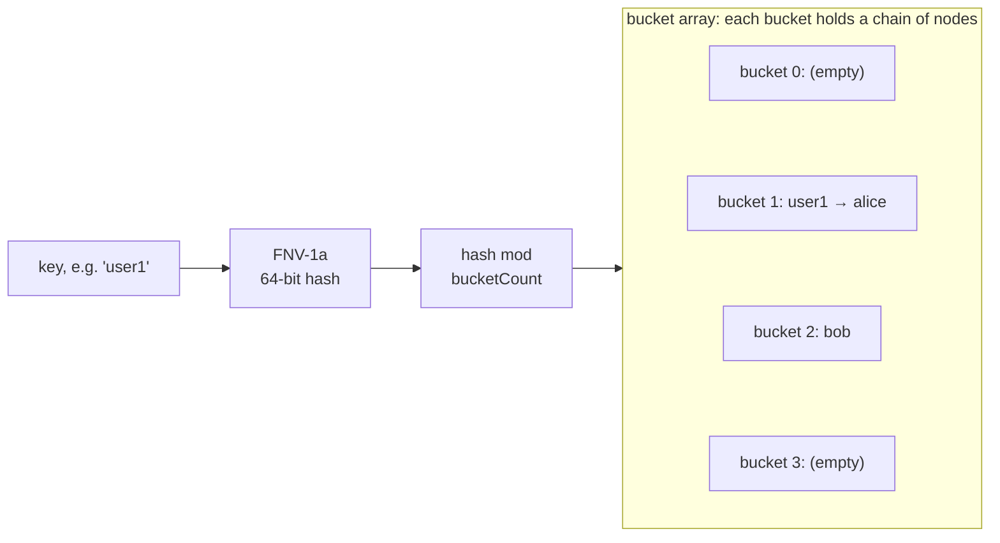
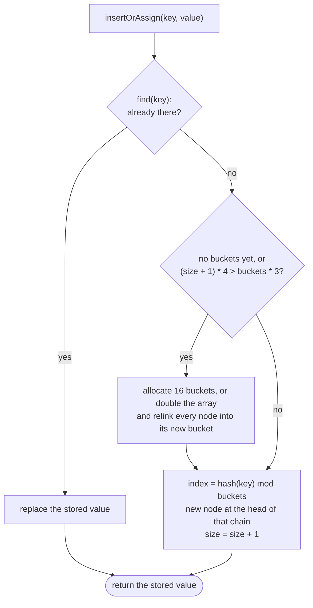
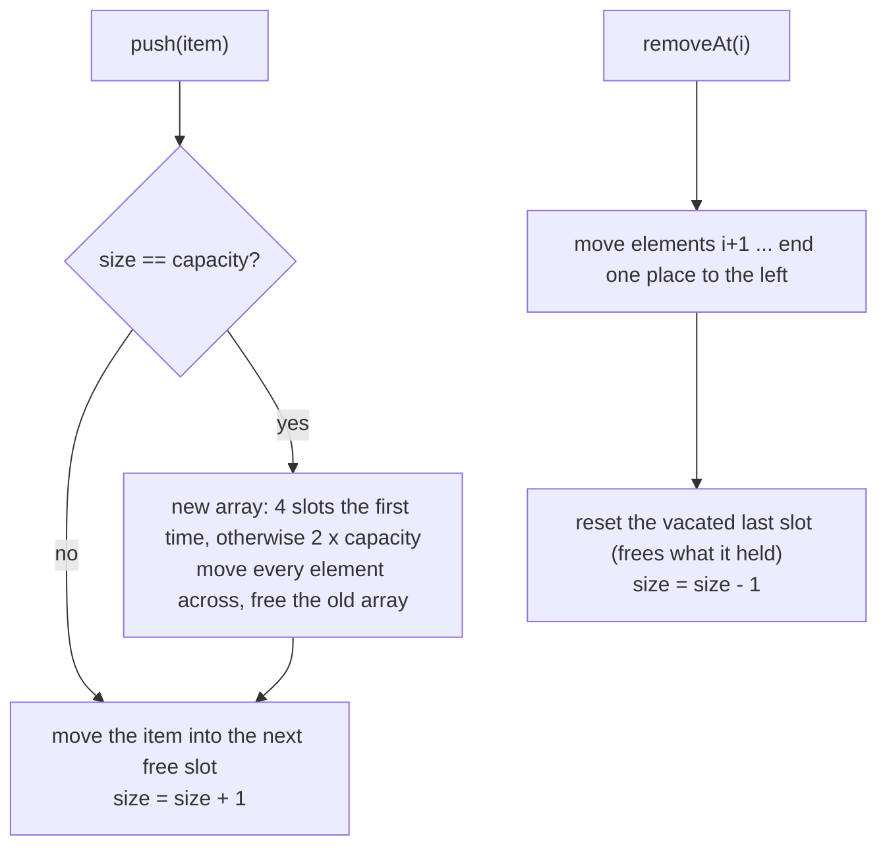
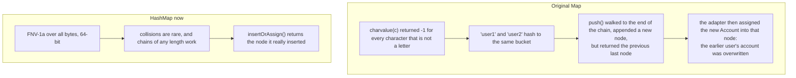
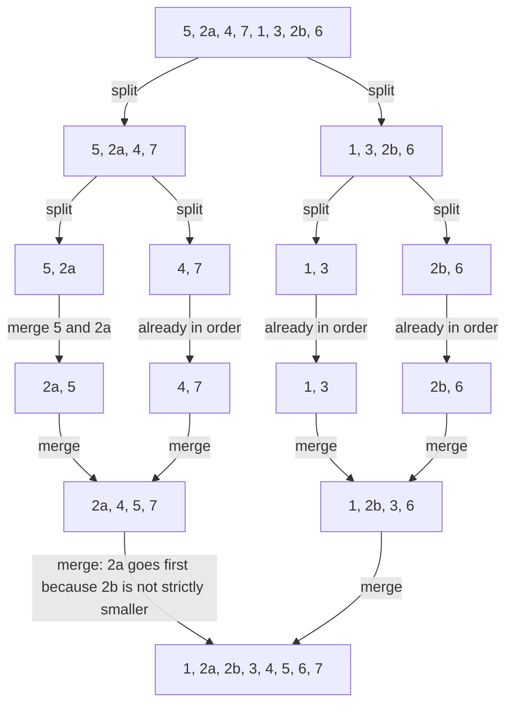
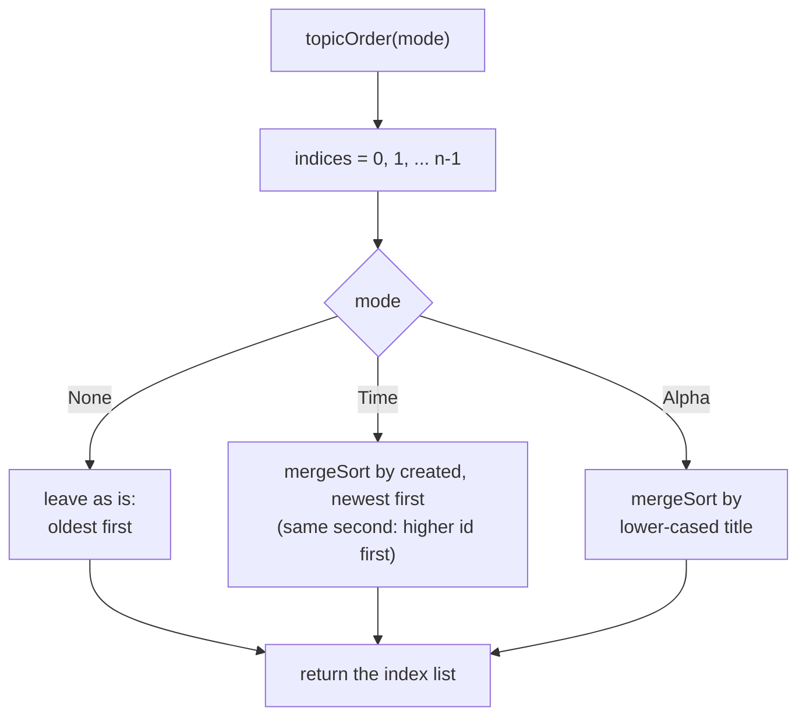
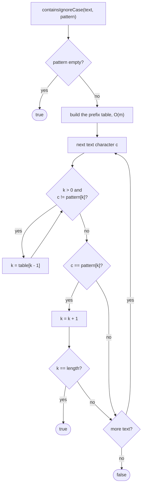
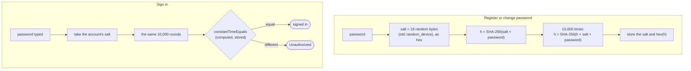
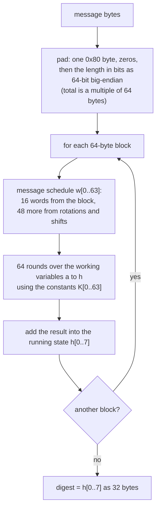

# Data structures and algorithms

The hand-written pieces the project is about, and how they work. Part of the [README](../README.md).

Contents: [Overview](#overview) · [HashMap](#hashmap) · [Vector](#vector) · [Why accounts used to overwrite each other](#why-accounts-used-to-overwrite-each-other) · [Merge sort and topic ordering](#merge-sort-and-topic-ordering) · [Substring search (KMP)](#substring-search-kmp) · [Password hashing and SHA-256](#password-hashing-and-sha-256) · [What the main operations cost](#what-the-main-operations-cost)

## Overview

These are hand-written and are the point of the project. Nothing in `src/` uses `std::vector`,
`std::unordered_map` or `std::sort` for forum data.

| What | Where | How it works | Cost |
|---|---|---|---|
| `Vector<T>` | `src/Vector.h` | Dynamic array; capacity doubles when full | push amortised O(1), `removeAt` O(n), index O(1) |
| `HashMap<K,V>` | `src/HashMap.h` | Separate chaining, 64-bit FNV-1a over every byte, doubles at load factor 0.75, rehash relinks nodes so pointers stay valid | find/insert/erase O(1) average |
| `mergeSort` | `src/Sort.h` | Stable top-down merge sort that moves elements instead of copying | O(n log n), O(n) scratch |
| `containsIgnoreCase` | `src/StringSearch.cpp` | Knuth-Morris-Pratt substring search | O(n + m) |
| SHA-256 | `src/Sha256.cpp` | FIPS 180-4, checked against the NIST vectors | |

Where they are used: accounts and web sessions live in a `HashMap`; topic ordering is a
`mergeSort` over topic indices (so each viewer can pick their own order without changing stored
data); search uses KMP; every list in the program is a `Vector`.

## HashMap

`src/HashMap.h`. A key is hashed, reduced to a bucket, and the bucket holds a chain of nodes. New
nodes go on the front of the chain (so `user1`, added after `alice`, comes first). Accounts and web
sessions are stored this way. The array starts
at 16 buckets and doubles when `size / buckets` would pass 0.75.

`insertOrAssign` in full. On a resize the existing nodes are *relinked* into the new array, not
copied, so a pointer returned earlier by `find` stays valid until that entry is erased.

## Vector

`src/Vector.h`. Capacity doubles, so `push` is amortised O(1). The old version grew by 4 each
time, which is O(n) per push in the long run.

## Why accounts used to overwrite each other

The original `Map` had two bugs that combined. Both are covered by the unit tests now: one forces
every key into the same bucket and removes from the head, middle and tail of the chain.

## Merge sort and topic ordering

`src/Sort.h`. Top-down merge sort, O(n log n) time and O(n) scratch space. It *moves* elements
instead of copying them (the old selection sort copied whole topics, with all their posts, on every
swap). It takes from the right run only when strictly smaller, so equal items keep their original
order. The example below has two equal 2s (`2a` came first) and shows `2a` staying ahead of `2b`.

Topics are never reordered in memory. `topicOrder` builds a list of *indices* and sorts that, so
each web visitor can pick their own order, a sort needs no write to disk, and the stored `topics_`
vector always stays in order of creation.

## Substring search (KMP)

`src/StringSearch.cpp`. Knuth-Morris-Pratt, O(n + m), case-insensitive for ASCII. The prefix table
holds, for each position `i`, the length of the longest proper prefix of `pattern[0..i]` that is also
a suffix of it. When a character does not match, the table says how far to fall back inside the
pattern, so the text is read exactly once and never backed over.

Worked example, pattern `ababc` in text `abababc`. The prefix table is `0 0 1 2 0`.

| Text character | Matched before (k) | Step | k after |
|---|---|---|---|
| a | 0 | matches `a` | 1 |
| b | 1 | matches `b` | 2 |
| a | 2 | matches `a` | 3 |
| b | 3 | matches `b` | 4 |
| a | 4 | `c` expected, no match: fall back to `table[3]` = 2, then `a` matches pattern[2] | 3 |
| b | 3 | matches `b` | 4 |
| c | 4 | matches `c`, k equals the pattern length | 5, found |

## Password hashing and SHA-256

`src/Sha256.cpp`, `src/Account.cpp`. SHA-256 is written by hand and checked against the NIST test
vectors. A password is never stored: only a random salt and the result of 10,000 rounds. For a
username that does not exist, login still does the same amount of hashing, so how long it takes
does not reveal which names are registered.

## What the main operations cost

*T* topics, *P* posts in a topic, *A* accounts, *L* likes on one item, *N* the total size of the data.

| Operation | Cost | Why |
|---|---|---|
| Find an account | O(1) average | `HashMap` |
| Check a password | constant, about 10,000 SHA-256 rounds | deliberately slow |
| Find a topic by id | O(T) | linear scan of `topics_` |
| Find a post by id | O(T + P) | scan for the topic, then its posts |
| Order the topics | O(T log T) | `mergeSort` on indices |
| Add a post | O(T + P) plus a save | find the topic, compare text with its posts |
| Like or unlike | O(L) plus a save | `likedBy` is a `Vector`, searched linearly |
| Search | O(total text) | one KMP pass per title, description and post |
| Save | O(N + A log A) | the whole file is rewritten, accounts sorted by name |

The linear scans and the full rewrite on every change are the main trade-offs: fine for a forum of
this size, and the first things to change (an id index, an append-only log or a database) if it grew.
