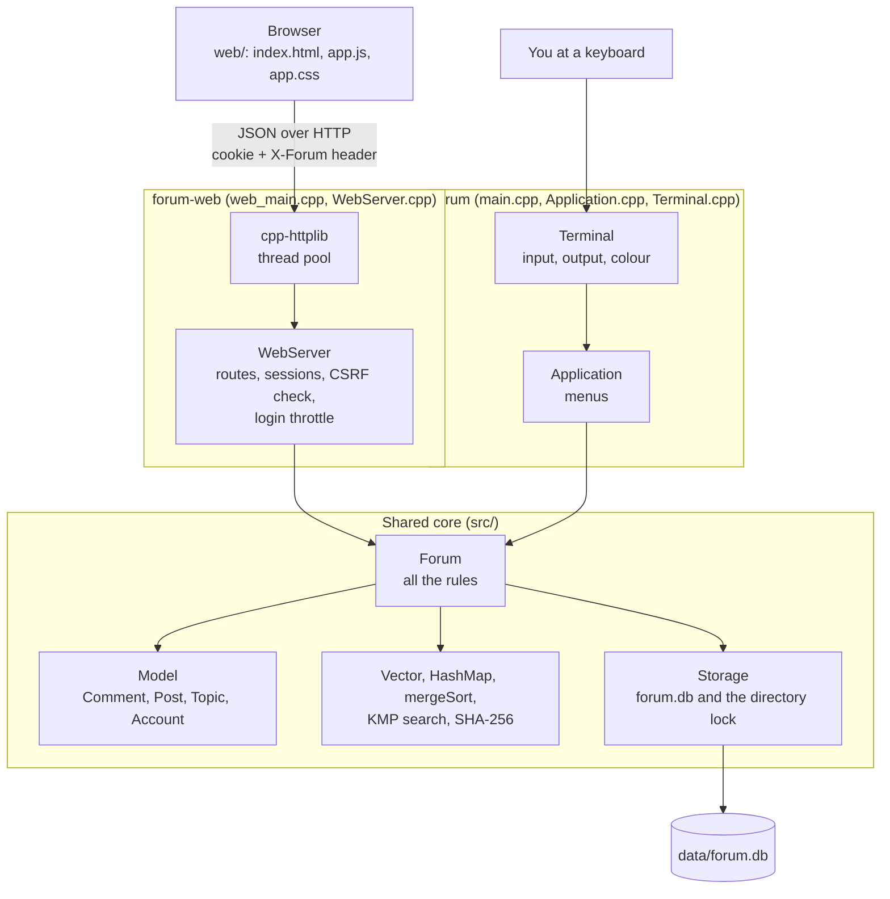
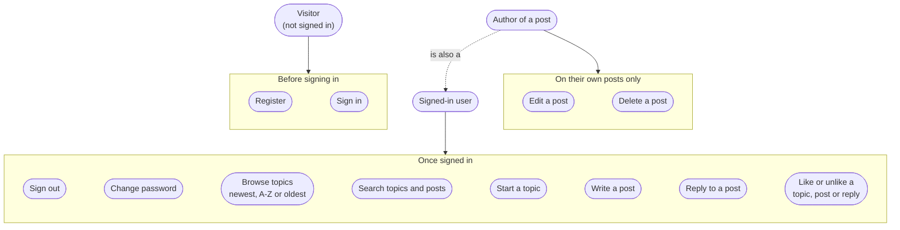
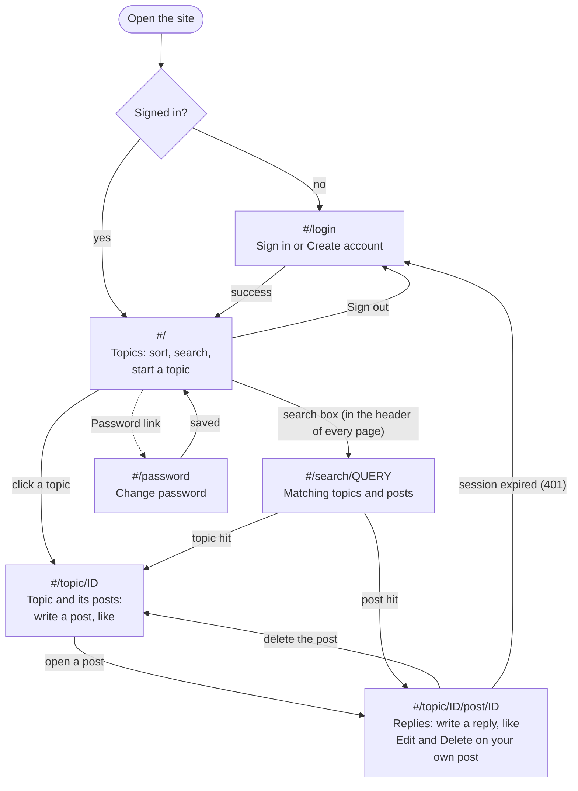
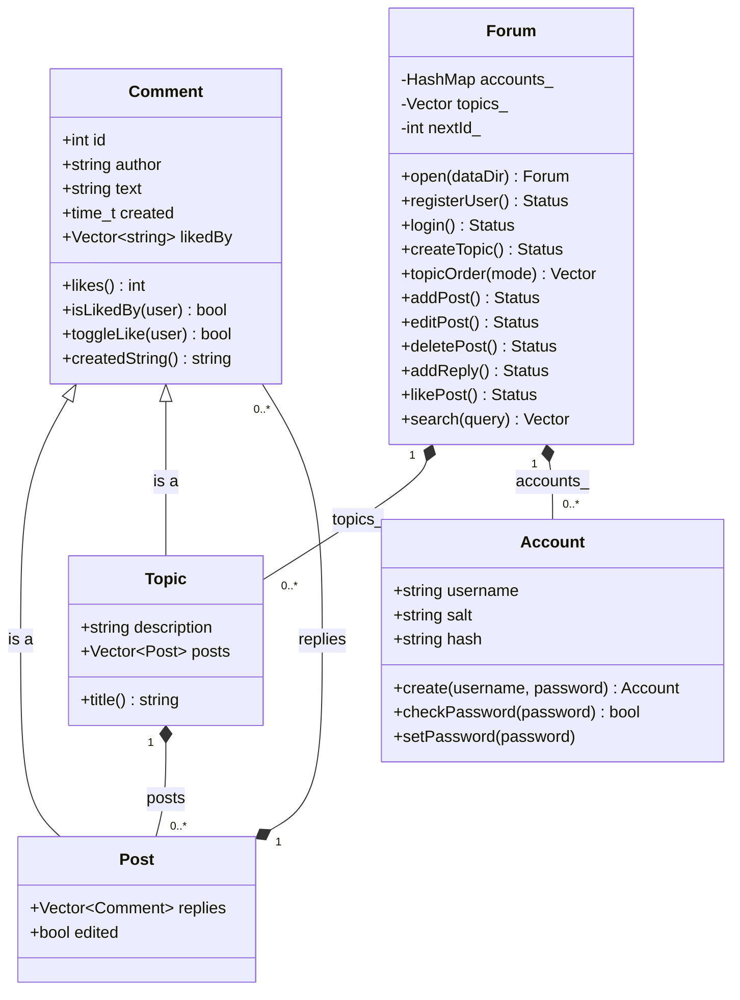
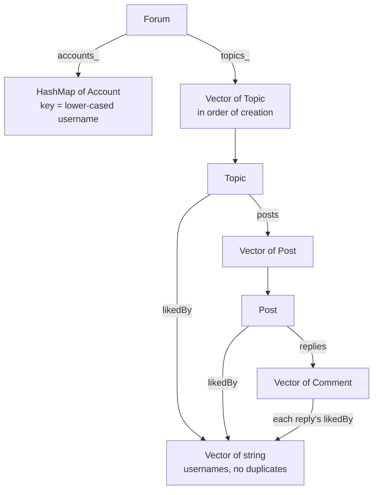
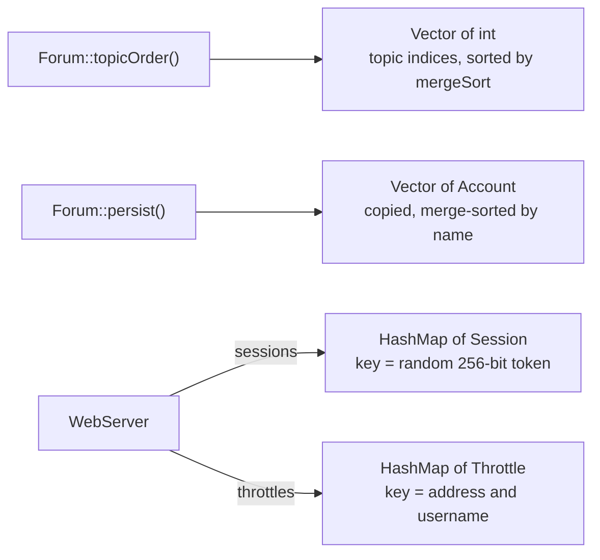
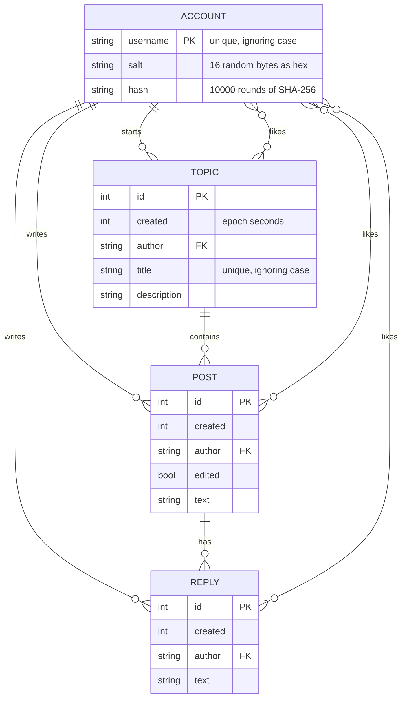
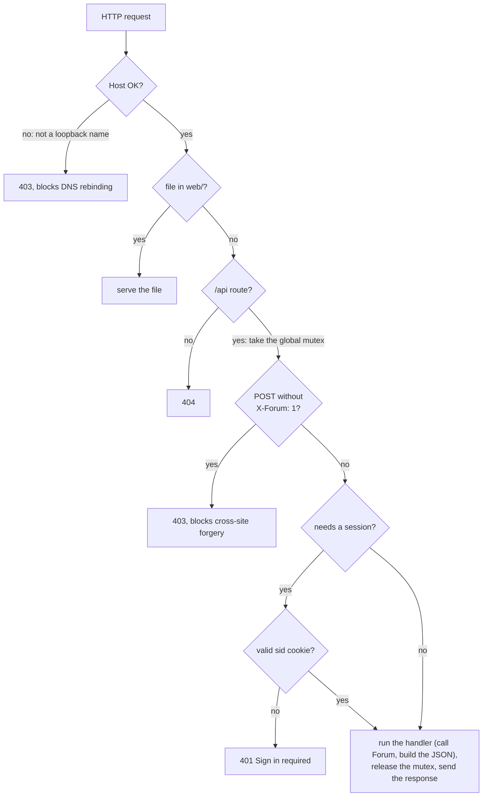
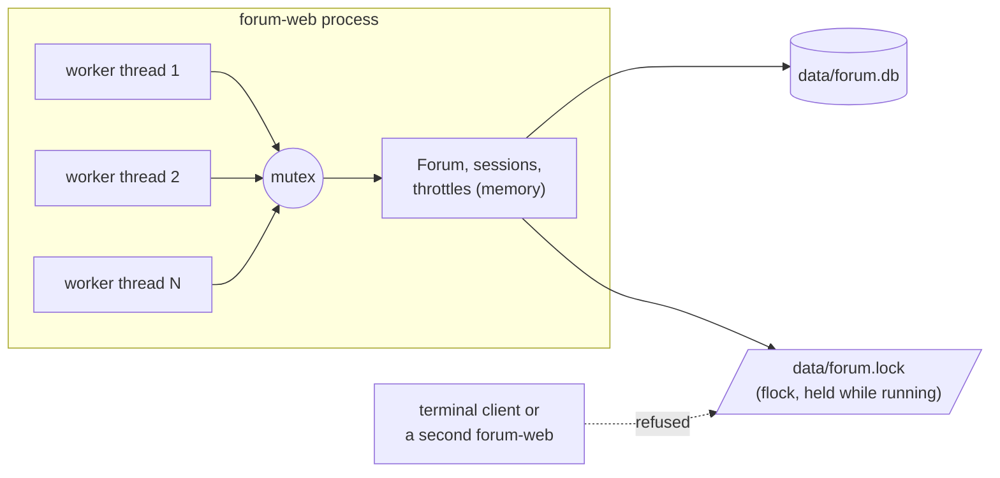

# Architecture

How the forum is put together and who uses it. Part of the [README](../README.md).

Contents: [Components](#components) · [Project layout](#project-layout) · [Who uses it](#who-uses-it) · [Structure](#structure) · [A web request, and concurrency](#a-web-request-and-concurrency)

## Components



`Forum` knows nothing about HTTP or terminals, so the rules (who may edit what, one like per
user, unique names) live in one place and are unit-tested directly.

## Project layout

```
src/        the C++ code
  Vector.h HashMap.h Sort.h StringSearch.* Sha256.*     data structures and algorithms
  Comment.* Post.h Topic.h Account.*                    the model
  Storage.*   forum.db reader/writer and the directory lock
  Forum.*     the forum's rules (shared by both front-ends)
  WebServer.* Json.h web_main.cpp                       web front-end (forum-web)
  Terminal.* Application.* main.cpp                     terminal front-end (forum)
web/        the browser app: index.html, app.js, app.css
tests/      unit tests, end-to-end scripts, and the browser check
third_party/httplib.h    cpp-httplib v0.58.0 (MIT), the only third-party code
```

## Who uses it

### Use cases

There are no administrators or moderators: nobody can edit or delete another person's content, and
there is no way to delete a topic.



### User flow in the web app

Each box is a screen of the single-page app (`web/app.js`); the labels are its URL hashes.



### Screens

| Sign in | A post with replies | Phone |
|---|---|---|
|  |  |  |

## Structure

### Classes

The model is three small classes and an account. `Post` and `Topic` extend `Comment` so that
likes, ids, authors and timestamps are written once.



### Where each data structure is used



Short-lived structures and the web layer's own tables:



### Data model on disk

The same shape as `forum.db` (see [Data file](reference.md#data-file)). Likes are not a separate table: each
topic, post and reply carries the list of usernames who like it. A post belongs to the topic whose
`TOPIC` line is above it in the file, and a reply to the `POST` line above it.



## A web request, and concurrency

The pipeline every request goes through, in order. "Host OK?" means the `Host` header names a loopback
address (`localhost`, `127.0.0.1` or `[::1]`) when the server is listening on loopback; "valid sid
cookie?" means a known token that has not been idle for over 24 hours; the mutex is released when
the response has been built. Every response, including errors and static
files, also carries `Content-Security-Policy`, `X-Content-Type-Options: nosniff`,
`X-Frame-Options: DENY`, `Referrer-Policy: no-referrer` and `Cache-Control: no-store`.



There are two levels of locking. Threads inside the web server share one mutex. Separate
programs are kept apart by a file lock, because each one holds all the data in memory and rewrites
the file: two of them at once would silently overwrite each other's changes.


