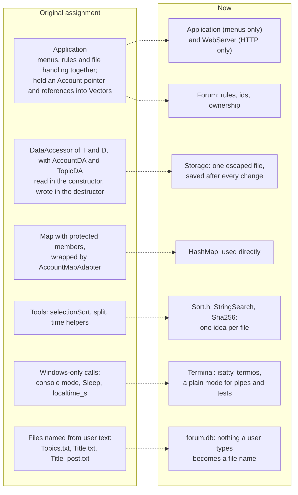
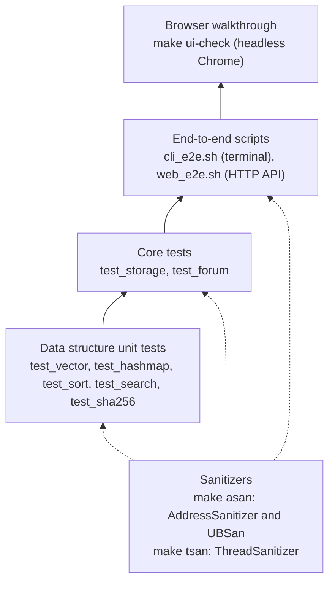

# Design decisions

The patterns used, the alternatives that were weighed, and how the design changed from the original assignment. Part of the [README](../README.md).

Contents: [Patterns and idioms](#patterns-and-idioms) · [Decisions and the alternatives](#decisions-and-the-alternatives) · [From the original design to now](#from-the-original-design-to-now) · [What changed from the original assignment](#what-changed-from-the-original-assignment) · [Test strategy](#test-strategy)

## Patterns and idioms

| Idea | Where | What it buys |
|---|---|---|
| Layered architecture, separation of concerns | front-ends, `Forum`, `Storage`, data structures | Rules live in one place and are testable without HTTP or a terminal |
| Facade | `Forum` | One small API in front of the model, storage and algorithms |
| Whole-state snapshot persistence | `storage::Snapshot`, `Forum::persist` | Simple, atomic, no partial updates to reason about |
| RAII | `Vector`, `HashMap` own their memory; `DataLock` closes its file (releasing the lock); `std::lock_guard` | No leaks, locks released on every path |
| Rule of five with copy-and-swap | `Vector`, `HashMap` | Safe copy, move and self-assignment (the original had double-free bugs here) |
| Strategy through templates | `HashMap<K, V, Hash>`, `mergeSort(vec, Less)` | The tests swap in a hash that sends every key to one bucket |
| Status codes for expected failures | `Forum` returns `Status` | "Not allowed" or "already exists" are normal outcomes, not exceptions |
| An exception only to unwind | `EndOfInput` in the terminal client | Leaves any depth of menu at the end of input |
| Stable surrogate keys | integer ids from a persisted counter | Positions shift on delete and sort; several browsers act at once |
| Pure ordering function | `topicOrder` | Sorting is a view, not a change to shared state |
| Validate at the boundary, then escape per context | `Forum` input rules; the file format escaping; JSON escaping; `textContent` in the browser | User text cannot break the file, the page or a terminal |
| Defence in depth | Host check, `X-Forum` header, `SameSite=Strict`, CSP, throttle | No single check is the only thing standing between a request and the data |

## Decisions and the alternatives

| Decision | Chosen | Alternatives | Why |
|---|---|---|---|
| Containers | Hand-written `Vector` and `HashMap` | The standard library's | They are the point of a DSA project; now correct and unit-tested |
| Build | A plain `Makefile` | CMake | Nothing extra to install; CMake would only matter if Windows came back |
| Storage | One escaped text file, saved atomically | A file per topic and per post (the original); SQLite; JSON | No dependency, readable, and nothing a user types becomes a file name. Cost: the whole file is rewritten on every change |
| Identity | Integer ids | Array positions | Positions change on delete and sort |
| Topic order | Computed per request | Sorting the stored vector (the original) | Each viewer picks their own order and nothing is written |
| Sort | Stable merge sort | Selection sort (the original), quicksort, insertion sort | O(n log n) in every case and stable. Quicksort is not stable and has an O(n²) worst case |
| Collisions | Separate chaining | Open addressing | Deleting is simple, and nodes never move, so pointers stay valid across a resize |
| Hash function | FNV-1a over all bytes | The original rolling hash (non-letters all counted as -1), `std::hash` | Simple, uses every byte, and is defined by this project rather than left to the standard library's implementation |
| Vector growth | Doubling | Adding 4 each time (the original) | Amortised O(1) |
| Search | KMP scan of the text | A naive scan; an inverted index | O(n + m) and a classic algorithm. An index would be faster for a large forum but must be kept in step with every edit |
| HTTP | cpp-httplib (one MIT header) | Writing an HTTP server; a bigger framework | Parsing HTTP is not what this project is about and is easy to get wrong |
| Front-end | Plain JavaScript, no build step | A framework; server-rendered pages | No dependencies, and `textContent` makes the XSS rule easy to follow |
| Thread safety | One global mutex | A lock per object; a single-threaded event loop | Simple and clearly correct, and checked with ThreadSanitizer. Throughput is not a concern here |
| Two processes | An exclusive file lock | Letting both run and merging; a database | Each process keeps everything in memory, so concurrent writers would lose updates |
| Passwords | Hand-written salted, iterated SHA-256 | Plain text (the original); bcrypt, scrypt or argon2 | Keeps the project free of dependencies and shows the idea. Real systems should use a purpose-built scheme |
| Sessions | Random tokens in an in-memory `HashMap` | Signed cookies or JWTs; a database table | Signing out is just deleting an entry, and there is no signing key to manage. Cost: a restart signs everyone out |
| Cross-site forgery | A required custom header, plus `SameSite=Strict` | A token in every form | Simple with `fetch`, and a page on another site cannot add the header without CORS |
| Likes | A list of usernames on each item | A bare counter | One like per user, and unliking, both need to know who |
| Editing | In place | Delete and re-create (the original) | Keeps replies, likes, id and creation time |
| Errors | `Status` values | Exceptions | Failures like "forbidden" are expected and easy to test |

## From the original design to now

## What changed from the original assignment

The terminal menus, the ASCII logo and the overall feature set are the same. Fixed along the way:

- It only built on Windows (`Windows.h`, `Sleep`, `localtime_s`, a Visual Studio project). It now
  builds anywhere with a C++20 compiler.
- **Accounts could overwrite each other.** The hash gave every non-letter the same value (so
  `user1` and `user2` collided) and `Map::push` returned the wrong node on a collision, replacing
  another user's account.
- Deleting a post corrupted the list (`Vector::pop` advanced the wrong index), and the container
  had double-free bugs in its copy and move assignment.
- Replies were duplicated on every save, and file names were built from user text: a topic called
  `Topics` overwrote the data file, a `/` in a post broke saving, and a `;` crashed the next start.
  Storage is now one safely escaped file.
- The edit/delete permission was checked against the topic's starter instead of the signed-in
  user: anyone could delete the starter's posts by typing the hidden command, while other people
  could not edit their own. Editing a post also threw away its replies, likes and date.
- End of input made the program loop forever, and data was only saved on a clean exit.
- Selection sort copied whole topics on every swap; it is now a merge sort that moves them.
- Likes were unlimited; there is now one per user.

## Test strategy

Each layer is checked on its own, and the layers above check them again from the outside.
`make asan` and `make tsan` rerun everything under the sanitizers; `make test` is the quick run.

What is covered: the containers (including the collision, growth and removal cases that were
broken before), the storage round trip with hostile text, every rule in `Forum`, the web API
(auth, CSRF header, ownership, escaping, 40 concurrent writers, restart persistence), scripted
terminal sessions (including end-of-input and the directory lock), and a browser walkthrough that
fails on any console error or Content-Security-Policy violation.

