# Processes and state machines

What happens, step by step, when the program starts and when someone uses it. Part of the [README](../README.md).

Contents: [Sequence diagrams](#sequence-diagrams) · [State machines](#state-machines)

## Sequence diagrams

### Start-up

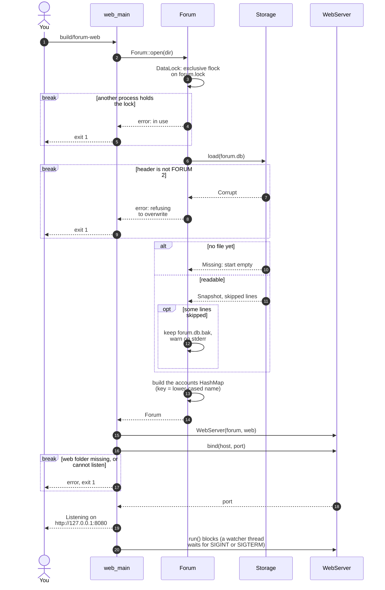

### Signing in

The throttle, the session table and the password check are separate pieces; the web layer owns the
first two and `Forum` owns the last.

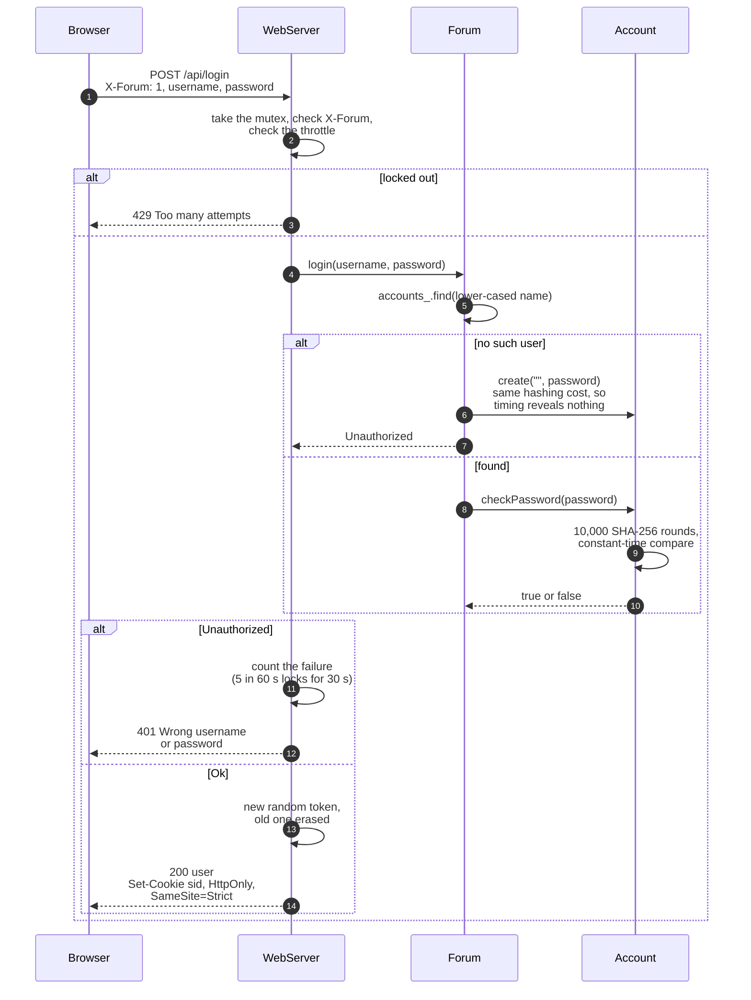

### Writing a post

Every change follows the same path: authenticate, validate, change memory, save, answer.

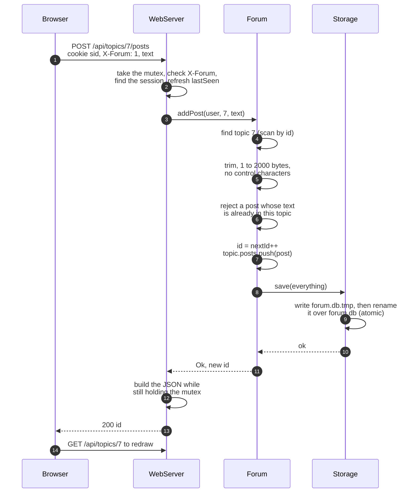

### Liking

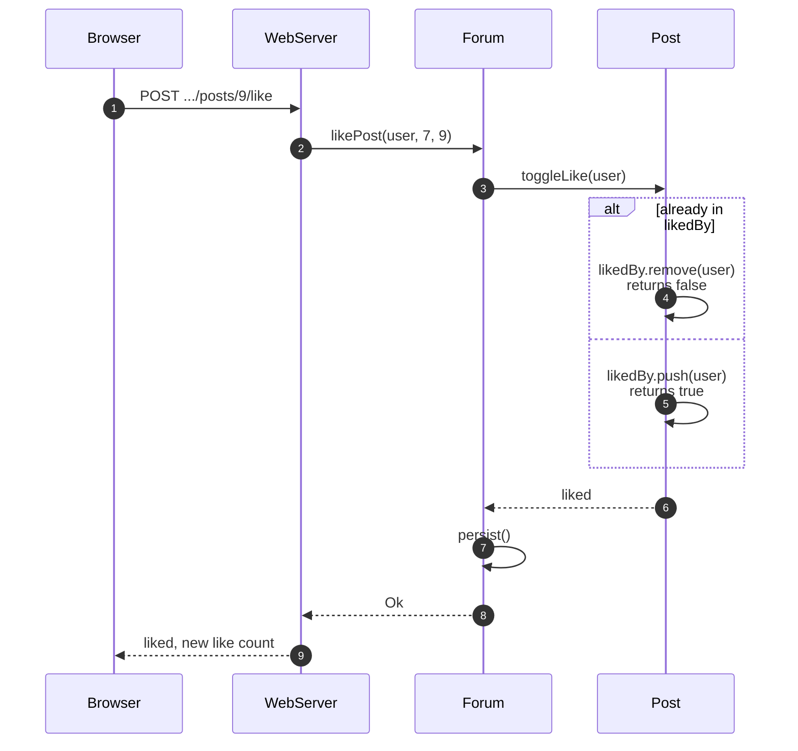

### Editing and ownership

The check is against the signed-in user. (The original compared against the topic's starter.)
Editing changes the text in place, so replies, likes, id and creation time all stay.

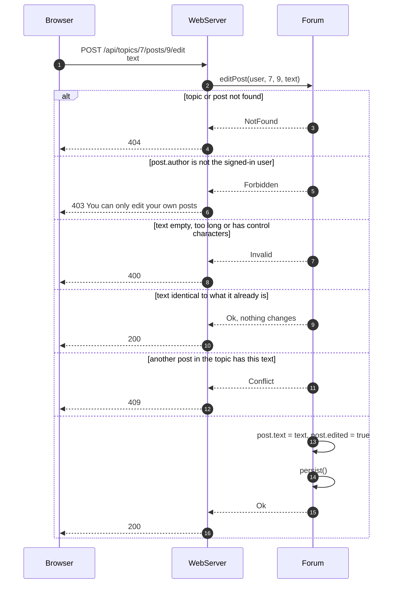

### Search

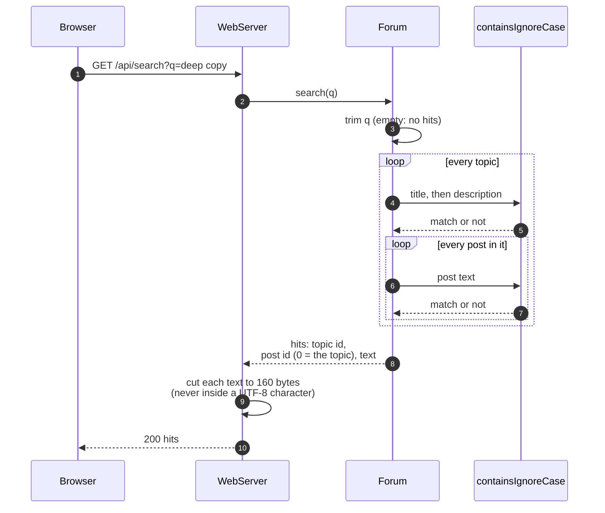

### A terminal session

The terminal client calls the same `Forum` methods. At the end of input (Ctrl-D, or a closed pipe)
it throws a private exception that unwinds out of whichever menu is open, so it cannot loop forever.

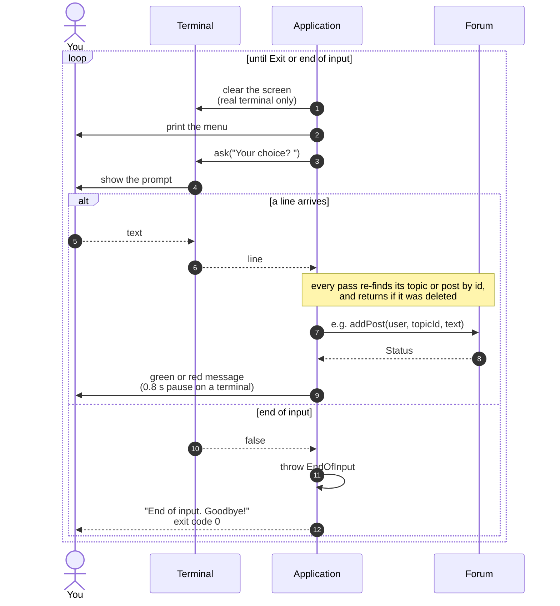

### Saving to disk

The file is replaced as a whole, atomically, so a crash or a full disk can never leave half a file.

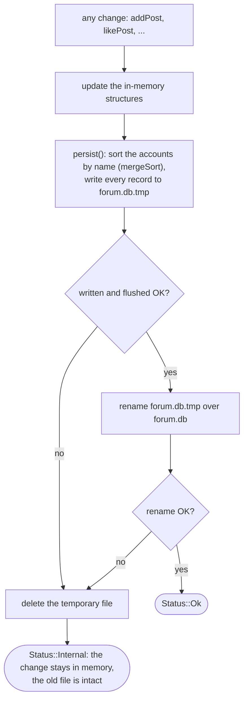

## State machines

### A web session

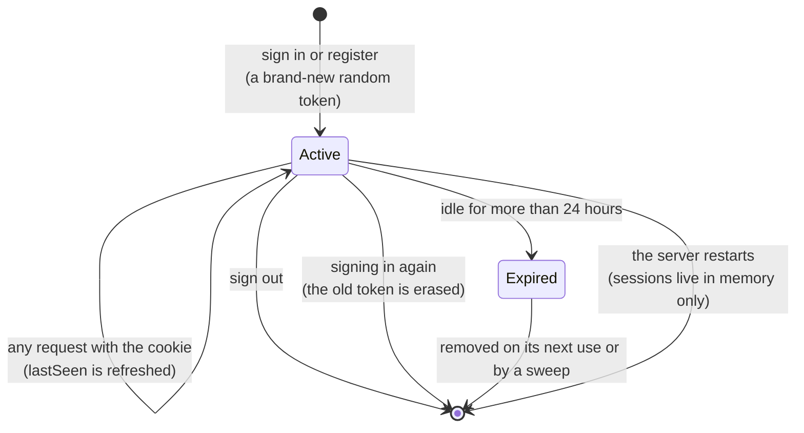

### The login throttle

One entry per remote address and username. A failure that arrives after the 60 s window has passed
starts the count again at 1.

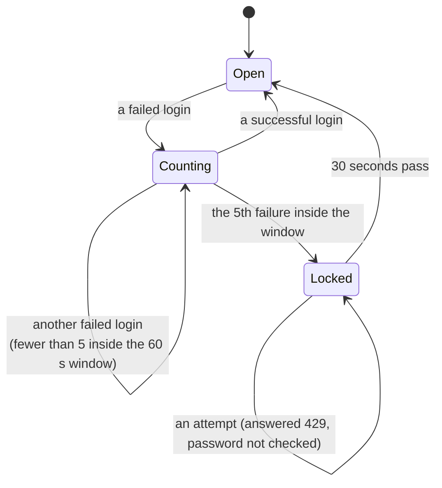

### Reading the data file

Lines that cannot be parsed are skipped and counted rather than aborting the load. A `POST` needs a
good `TOPIC` before it, and a `REPLY` a good `POST`, so one damaged line cannot attach later lines
to the wrong parent.

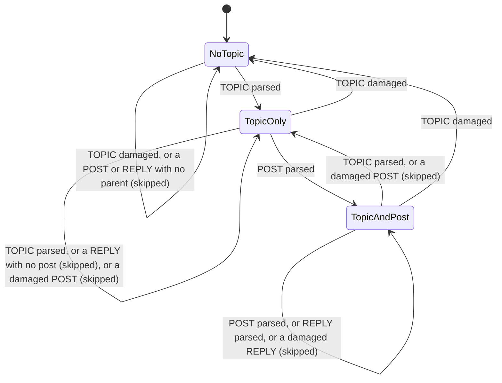
